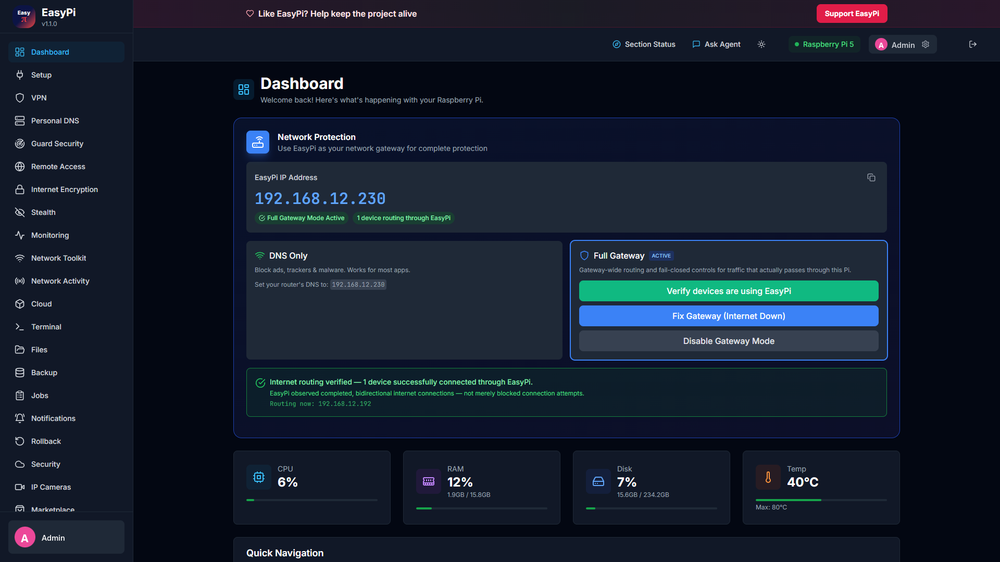
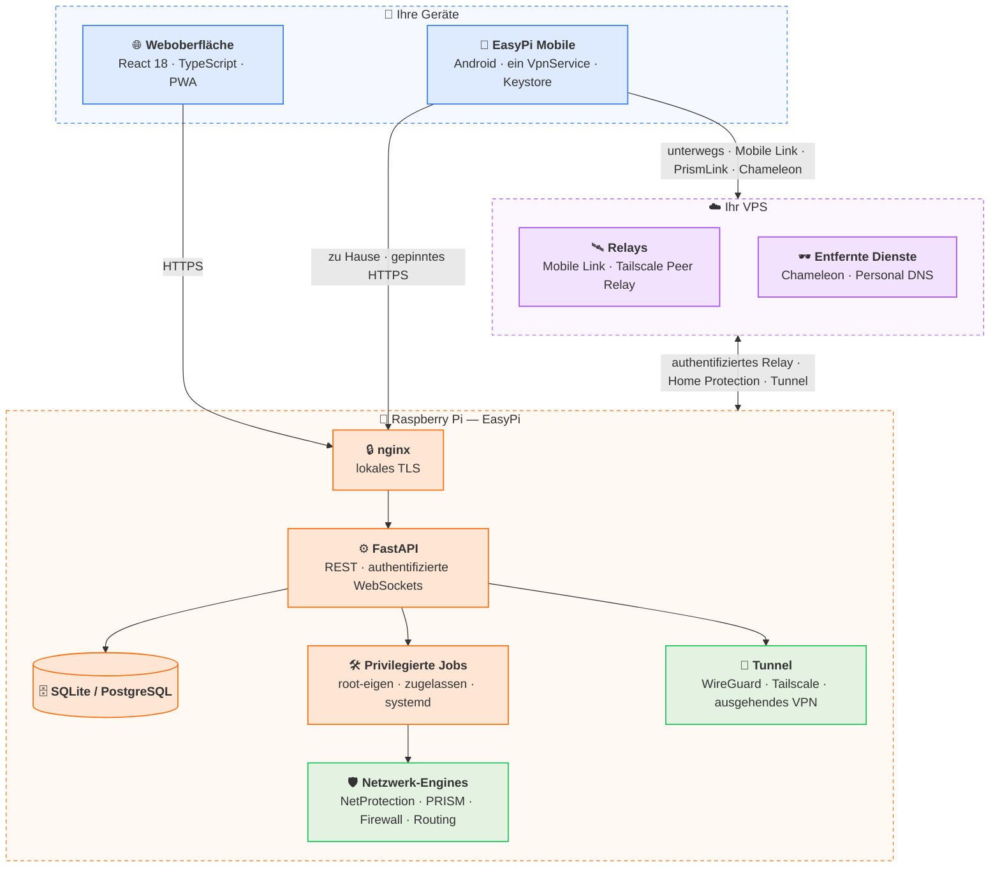

<a id="top"></a>

<p align="center">
  
</p>

<h1 align="center">EasyPi</h1>

<p align="center">
  <strong>Den Pi überwachen. Den Netzwerkpfad kontrollieren. Die Vertrauensgrenze sichtbar halten.</strong><br />
  Eine selbst gehostete Steuerzentrale für Raspberry Pi mit optionalen Werkzeugen für DNS, Gateway, VPN, Sicherheit, Speicher und Automatisierung.
</p>

<p align="center">
  <a href="README.md">English</a> ·
  <a href="README.ru.md">Русский</a> ·
  <a href="README.de.md">Deutsch</a>
</p>

<p align="center">
  <a href="VERSION"></a>
  <a href="#supported-platform"></a>
  <a href="#project-status"></a>
  <a href="LICENSE"></a>
</p>

<p align="center">
  <a href="#screenshots">Screenshots</a> ·
  <a href="#features">Funktionen</a> ·
  <a href="#deployment">Bereitstellung</a> ·
  <a href="#security">Sicherheit</a> ·
  <a href="#installation">Installation</a> ·
  <a href="#architecture">Architektur</a> ·
  <a href="#documentation">Dokumentation</a>
</p>

> [!WARNING]
> EasyPi befindet sich in aktiver Entwicklung und kann Routing, DNS, Firewall-Regeln sowie Systemdienste verändern. Verwenden Sie es nur auf eigener oder ausdrücklich zur Administration freigegebener Infrastruktur. Halten Sie einen lokalen Wiederherstellungsweg bereit und erstellen Sie eine Sicherung, bevor Sie Gateway- oder Update-Einstellungen ändern.

<a id="overview"></a>

## ✨ Auf einen Blick

| 🖥️ **Beobachten & betreiben** | 🛡️ **Schützen & klassifizieren** | 🌐 **Verbinden & bereitstellen** |
|:---:|:---:|:---:|
| Live-Diagramme für CPU, Arbeitsspeicher, Temperatur, Datenträger und Netzwerk | NetProtection-Richtlinien, PRISM-Flussklassifikation, SafeSearch, Zeitpläne und Quarantäne | WireGuard, Tailscale, Personal DNS und VPS-Bereitstellungsabläufe |

| 🔒 **Datenverkehr routen** | 💾 **Zustand schützen** | 🤖 **Lokal ausführen** |
|:---:|:---:|:---:|
| Ausgehendes WireGuard, OpenVPN, Outline und Chameleon für weitergeleiteten LAN-Datenverkehr | Verschlüsselte Sicherungen, signierte Updates, Rollback-Snapshots, Dateien und PiCloud | Ollama-Chat und Modellverwaltung auf eigener Hardware |

EasyPi liegt nicht automatisch im Pfad jedes Pakets. Für die DNS-Durchsetzung müssen Clients den EasyPi-Resolver verwenden. Gateway-Regeln, gerätebezogenes Routing, Kill-Switch und Zulassungsrichtlinien wirken nur auf den relevanten Datenverkehr, wenn dieser tatsächlich durch den Pi läuft.

<a id="screenshots"></a>

## 📸 Screenshots

<p align="center">
  
</p>

<a id="project-status"></a>

## 📌 Projektstatus

| | Aktueller Stand |
|---|---|
| **Version** | [`1.1.6`](VERSION) |
| **Offizielles Binärziel** | Raspberry Pi OS Lite 64-bit · Debian Trixie · `aarch64` |
| **Entwicklung** | Aktiv; das Verhalten kann je nach Hardware, vorgeschaltetem Routing, IPv6 und Drittanbieterdiensten variieren |
| **Binärinstallation** | Der Vertrag für signierte Installationen ist definiert, der unabhängige Auslieferungskanal für Bootstrap und Schlüssel jedoch noch nicht vollständig |
| **Marketplace** | Schreibgeschützte Vorschau; kein Paket-Installer |
| **Lizenz** | Source available; ausschließlich für persönliche, nichtkommerzielle Heim- oder Laborzwecke |

<a id="features"></a>

## 🚀 Funktionen

### 🖥️ Dashboard, Überwachung und Betrieb

- Live-Werte für CPU, Arbeitsspeicher, Temperatur, Datenträger und Netzwerk über authentifizierte WebSockets.
- Responsive Diagramme für kürzlich im Browser erfasste Werte. Sie sind keine dauerhafte Verlaufsdatenbank für jede Metrik.
- Geführte Installations- und Konfigurationsabläufe für **WireGuard**, **Tailscale** und **Ollama**.
- Jobs, Ereignis-Postfach, signierter Update-Ablauf, Rollback-Verlauf und Zustandsdiagnose.
- Dateiverwaltung, Upload/Download und Bearbeitung im Browser sowie ein authentifiziertes Administrator-Terminal.
- Installierbare PWA-Hülle mit teilweise verfügbarer Offline-Navigation; API-gestützte Funktionen benötigen weiterhin den Pi.

### 🛡️ Guard, NetProtection und PRISM

- Domain- und Dienstrichtlinien, SafeSearch, Zeitpläne, Regeln für Erwachseneninhalte sowie optionale Regeln für neu registrierte Domains.
- Gerätebezogene Richtlinien, DNS-Aktivität, Umgehungssignale, Quarantäne, Bedrohungsanalysen und Flussklassifikation.
- Ansicht **Blocked & Allowed**: alle Domains, die der netzwerkweite Schutz gesperrt hat, getrennt nach Seiten, die jemand öffnen wollte, und Hintergrund-Trackern, jeweils mit dem Grund der Sperre. Ein Klick gibt genau diesen Host frei oder sperrt ihn wieder; gemeinsam genutzte Zonen wie `co.uk` lassen sich nicht freigeben, und Kindersicherung, Zeitpläne sowie andere Geräteeinschränkungen werden nie umgangen.
- Signierte und gepinnte Sicherheitsfeed-Verarbeitung für geprüfte Adult-, NRD- und Tor-Richtliniendaten.
- Die Zulassung unbekannter Geräte kann anhand eines beobachteten **MAC+IPv4-Paares** nach dem Fail-closed-Prinzip sperren.

> [!IMPORTANT]
> Erkennung und Filterung arbeiten nach dem Best-Effort-Prinzip. Verschlüsselter, neuartiger, gefälschter oder nicht durch den Pi laufender Datenverkehr kann der Klassifikation entgehen. Die MAC+IP-Zulassung ist keine kryptografische Authentifizierung und schützt nicht vor einem böswilligen LAN-Teilnehmer, der beide Werte kopiert.

### 🌐 VPN und Fernzugriff

- Eingehende WireGuard-Profile mit QR-Codes für die Client-Einrichtung.
- Tailscale-Status, DNS-Einstellungen, Geräteverwaltung und Routenfreigabe.
- Fernzugriffsabläufe, bei denen die Administration hinter einem vertrauenswürdigen LAN oder einem authentifizierten Tunnel bleibt.
- Anbieterabhängige Funktionen unterliegen weiterhin dem installierten Dienst, Konto und dessen Konfiguration.

### 🔒 Internet Encryption und Stealth

- Ausgehende **WireGuard**-, **OpenVPN**- und **Outline**-Profile.
- Routing für das gesamte Netzwerk oder pro Gerät für weitergeleiteten LAN-Datenverkehr.
- Fail-closed-Steuerungen für IPv4/IPv6 und Tunnel-Zustandsanzeige.
- Bereitstellung von **Chameleon** auf einem benutzereigenen VPS über verifiziertes SSH; der Datenverkehr soll dabei gewöhnlichem HTTPS ähneln.
- Der Pi-Client läuft als eigener Systembenutzer in einer eingeschränkten systemd-Sandbox ausschließlich mit `CAP_NET_ADMIN`; seine PSK-Konfiguration bleibt root-eigen und für den Client schreibgeschützt.

> [!NOTE]
> Chameleon verschlüsselt den gesamten weitergeleiteten Internetverkehr ausgewählter Geräte zwischen dem Pi und Ihrem VPS. Einzelne Smartphone-Apps umgehen den Tunnel nicht selektiv. Ziele im lokalen Netzwerk bleiben absichtlich im LAN; IPv6-Verkehr ohne geschützten Pfad wird blockiert und nicht direkt weitergeleitet. Vom Pi selbst erzeugte Verbindungen gehören nicht zur Route des ausgewählten Geräts. Dazu zählen die externen DNS-Abfragen von Unbound, die ohne eine gesonderte Tunnelroute das normale WAN verwenden können. Wie bei jedem VPN endet die Verschlüsselung am eigenen VPS, dessen Betreiber daher Teil der Vertrauensgrenze bleibt. Die Tarnung von Chameleon erschwert die DPI-Klassifizierung, verspricht jedoch weder Anonymität noch absolute Unerkennbarkeit.

<details>
<summary><strong>Transport und Schutz von Chameleon</strong></summary>

- Auf dem VPS nimmt ein echtes nginx-Frontend TLS 1.2/1.3 und HTTP/2 auf TCP-Port 443 an. Das Chameleon-Backend lauscht ausschließlich auf Loopback, läuft unter einem unprivilegierten Dienstkonto und ist über einen aus dem PSK abgeleiteten privaten Pfad erreichbar; fremde Anfragen erhalten die statische Tarnseite oder eine normale 404-Antwort.
- Der Pi-Client verwendet uTLS mit einem geprüften Chrome-151-Profil für Desktop- und Mobilgeräte, das vom gepflegten Chrome-Template abgeleitet ist. TLS-Identität, HTTP-Header, Client Hints und Sprache bleiben während einer Verbindung konsistent.
- In der standardmäßigen nginx-Bereitstellung laufen authentifizierte Uplink-Anfragen und der sequenzierte Downlink-Stream über die echte öffentliche HTTP/2-Verbindung und einen aus dem PSK abgeleiteten privaten Pfad. Der Quellcode enthält außerdem einen ausgehandelten bidirektionalen HTTP/2-`CONNECT`-Transport für das direkte Go-Frontend; nginx mode kündigt ihn jedoch bewusst nicht an, weil der Loopback-Proxy-Hop HTTP/1.1 verwendet. Keiner der Transporte fällt auf das direkte WAN zurück.
- Jedes Tunnelpaket und jede weitergeleitete DNS-Nutzlast wird innerhalb von TLS zusätzlich mit sitzungsgebundenen, richtungsgetrennten XChaCha20-Poly1305-Schlüsseln geschützt, die per HKDF-SHA256 abgeleitet werden. Eine einmalige Server-Challenge erzeugt die Sitzung; authentifizierte 64-Bit-Zähler und ein atomares gleitendes Fenster verwerfen Duplikate und alte Pakete. Anfrage-HMACs sind an die aktive Sitzung, HTTP-Methode und den Pfad gebunden; nach einem Serverneustart werden alte Sitzungen abgewiesen. Client und Server verlangen diese Protokollversion und fallen nicht unbemerkt auf das frühere Verfahren zurück.
- Größenklassen für Pakete, begrenztes TLS-Record-Shaping, gebündelte Bestätigungen und aktivitätsabhängige Verbindungsepochen reduzieren feste Größen- und Zeitmuster. Im Leerlauf wird kein künstlicher Tarnverkehr erzeugt.
- IP Shield bindet den Client ohne erforderliches öffentliches Tarn-Domain-SNI an den öffentlichen IPv4-Endpunkt und das geprüfte Zertifikat. Fremde öffentliche Anfragen enden bei nginx und erhalten die statische Tarnseite oder eine normale 404-Antwort, ohne das Loopback-Backend zu erreichen. Die VPS-IP wird dadurch nicht verborgen und kann weiterhin direkt gesperrt werden.
- Für geschützte Geräte verhindern persistente Firewall-Guards, striktes DNS-Routing über `cham0`, die Sperre von IPv6 ohne geschützte Route und der Kill-Switch einen unbemerkten direkten Fallback bei Ausfall von Tunnel, Resolver oder Dienst. QUIC kann gesperrt werden, damit Anwendungen die Verbindung über den geschützten TCP-Pfad erneut versuchen.

Chameleon bleibt ein selbst gehosteter Single-Hop-Tunnel. Ein Netzwerkbeobachter sieht weiterhin die Verbindung zum VPS und kann das Verhalten eines langlebigen Datenstroms klassifizieren; TCP über TCP kann außerdem Verzögerungen bei Paketverlust verstärken. Diese Grenzen sind von den oben beschriebenen Vertraulichkeits- und Fail-closed-Eigenschaften zu unterscheiden.

</details>

### 🧅 Personal DNS

- Bereitstellung und Verwaltung eines DNS-Dienstes auf einem kompatiblen VPS über SSH.
- Filterung, Zustandsprüfungen, Bereitstellungsverlauf und WireGuard-Clientkonfiguration.
- DoH/DoT, wenn eine Domain und ein Zertifikat konfiguriert sind.
- Ausdrückliche Prüfung und Bestätigung des SSH-Hostschlüssels vor der Bereitstellung.

Personal DNS ist ein VPS-Ablauf und von der lokalen NetProtection-DNS-Durchsetzung auf dem Pi getrennt.

### 🤖 Lokale KI mit Ollama

- Lokaler Chat, Gesprächssitzungen, Laufzeitstatus, Modellauswahl, Installation und Entfernung.
- Für jede Frage wird lokal eine begrenzte Auswahl relevanter Abschnitte aus EasyPi-README, UI-Hilfe sowie geprüfter Chameleon-, PRISM- und Sicherheitsdokumentation abgerufen. Laufzeitdaten, `.env`, Datenbanken, Protokolle, Schlüssel und Benutzerdateien werden niemals indiziert.
- Entwürfe für Erklärungen und Befehlsempfehlungen ohne Abhängigkeit von einem gehosteten LLM-Anbieter.
- Modellverfügbarkeit und Leistung hängen von der Pi-Hardware und der installierten Ollama-Laufzeit ab.

Der Dokumentationskontext vermittelt Wissen über EasyPi, enthält aber keinen aktuellen Systemzustand. Verwenden Sie Section Status oder den Diagnose-Agenten für aktuelle Dienst-, Geräte- und Konfigurationsdaten. Prüfen Sie vorgeschlagene Befehle immer vor der Ausführung.

### 🩺 Diagnose-Agent

- Ein modularer Diagnose-Gateway sammelt begrenzte Fakten zu Diensten, Netzwerk, Speicher, Updates, Sicherungen, Kameras und weiteren EasyPi-Subsystemen.
- Schreibgeschützte Probes können den aktuellen Zustand erklären und mehrere unabhängige Prüfungen in einer Anfrage verbinden.
- Zustandsändernde Aktionen stammen aus einer Positivliste und werden nur bei aktuellen, in sich konsistenten Ausgangsdaten angeboten.
- Als sensibel markierte Aktionen benötigen einen authentifizierten Administrator und ein ausdrückliches Bestätigungstoken.

Der Diagnose-Agent ist vom Ollama-Chat getrennt. Er kann deterministische Probes und Aktionsverträge verwenden, ohne generierten Text als Berechtigung zur Befehlsausführung zu behandeln.

### 💾 Sicherungen, Dateien und Verschlüsselung

- Manuell gestartete verschlüsselte Sicherungen des vollständigen Zustands oder nur der Konfiguration.
- Sicherungsstatus, Abbruch, Download, Wiederherstellungsvorschau, Wiederherstellung und Löschen.
- Passphrasengeschützte `.epikey`-Recovery-Pakete zur Wiederherstellung verschlüsselter Sicherungen auf einem anderen EasyPi-Host.
- Clientseitige **EPEC-v2**-Verschlüsselung in PiCloud mit AES-256-GCM und PBKDF2-SHA-256 bei 600.000 Iterationen.
- Chunk-basierte Verschlüsselung, verschlüsselte Metadaten, Größenauffüllung und Entschlüsselung älterer EPEC-v1-Dateien.
- PiCloud-Dateisuche, Tags, Duplikaterkennung, Massenoperationen und Freigabelinks mit optionalem Passwort und Ablaufzeitpunkt.

#### Dateien an PiCloud senden

| Methode | Maximale eingehende Datei | Verwendung |
|---|---:|---|
| **Telegram-Bot** | **20 MB** | Kleine Dateien, die an den konfigurierten EasyPi-Bot gesendet werden |
| **Tailscale Taildrop** | Kein festes EasyPi-Limit pro Datei | **Alle Dateien über 20 MB**; die praktische Grenze ist der verfügbare Speicherplatz |

Die Telegram-Grenze von 20 MB stammt aus dem Download-Limit von `getFile` in der Standard-Bot-API. Ein höheres lokales Dateilimit in EasyPi kann diese Plattformgrenze nicht anheben. Siehe [Telegram Bot API](https://core.telegram.org/bots/api#getfile).

Aktivieren Sie für größere Dateien **Send Files** in den Tailscale-Administratoreinstellungen, melden Sie EasyPi und das sendende Gerät mit demselben persönlichen Tailscale-Konto an und versehen Sie den EasyPi-Knoten nicht mit einem Tag. Wählen Sie unter Android die Datei, tippen Sie auf **Teilen**, wählen Sie **Tailscale** und anschließend diesen EasyPi. Unabhängig davon, ob eine Datei über Telegram oder Taildrop eintrifft, sortiert PiCloud sie nach ihrem Typ in **Photos**, **Videos**, **Documents**, **Music**, **Encrypted** oder **Files**. Der Browser muss nicht geöffnet bleiben.

Die Dateigröße bei Taildrop wird durch den verfügbaren Speicherplatz begrenzt. EasyPi hält **5 GiB** für den Systembetrieb frei und benötigt zusätzlich genügend temporären Platz für einen atomaren Import. Reicht der Speicher nicht aus, bleibt die Datei in Taildrop in der Warteschlange, EasyPi meldet **Not enough disk space**, und vorhandene PiCloud-Dateien werden nicht automatisch gelöscht.

„Vollständig“ bezeichnet ausgewählte EasyPi-Anwendungsdaten und verwaltete Systemkonfiguration, kein blockweises SD-Kartenabbild. Die Wiederherstellungsgrenze wird unter [Realität der Sicherungen](#backup-reality) erläutert.

### 💻 Terminal, Kameras und Benachrichtigungen

- Authentifiziertes interaktives PTY über WebSocket nur für Administratoren, mit Sitzungsmetadaten und zusammenfassenden Befehls-Audits.
- Verwaltung von RTSP-Kameras, Live-Ansicht, Snapshots, FFmpeg-Aufzeichnung, Speicher- und Aufbewahrungsregeln sowie Wiedergabe von Aufzeichnungen.
- Funktionsabhängige PTZ-Steuerung: Schwenken, Neigen, Zoomen, Stoppen, Ausgangsposition und gespeicherte Positionen, sofern Kamera und ausgewählter Adapter dies unterstützen.
- Ereignis-Postfach in der Anwendung, Web Push, SMTP-/E-Mail-Infrastruktur und Telegram-Integration.

Die Wiedergabe von Terminalsitzungen und das Ausschneiden eines Zeitbereichs aus Kameraaufzeichnungen gehören nicht zu diesem Release; vollständige Aufzeichnungen können wiedergegeben oder heruntergeladen werden. Die Kameraunterstützung hängt von Gerät, Codec, Netzwerk sowie der FFmpeg- und go2rtc-Konfiguration ab. Die Zustellung von Benachrichtigungen erfordert die jeweilige Anbieterkonfiguration.

### 🛍️ Marketplace

Der Marketplace ist bewusst transparent: Er ist eine **schreibgeschützte Vorschau geplanter Paketideen**. Derzeit existieren weder ein befüllter Produktionskatalog noch ein Installationslebenszyklus.

<a id="deployment"></a>

## 🧭 Bereitstellungsmodi

| Modus | Aktivierte Funktionen | Wirkungsgrenze |
|---|---|---|
| **🖥️ Nur Verwaltung** | Dashboard, Dienste, Jobs, Dateien, Terminal, Sicherungen, Kameras und lokale KI | Filtert für sich allein keinen Client-Datenverkehr |
| **🧠 DNS-Durchsetzung** | Domainregeln, SafeSearch, DNS-Analysen und DNS-basierte Dienststeuerung | Clients müssen EasyPi als Resolver verwenden |
| **🧭 Full Gateway** | NAT/Weiterleitung, gerätebezogenes Routing, Kill-Switches, Zulassung und strengere Fail-closed-Richtlinien | EasyPi muss der tatsächliche IPv4-/IPv6-Weiterleitungspfad sein |
| **☁️ Remote / VPS** | WireGuard-/Tailscale-Fernzugriff, Personal DNS und Stealth | Erfordert externe Dienste, Zugangsdaten und gegebenenfalls die Prüfung des SSH-Hostschlüssels |

> [!TIP]
> Bereiten Sie vor der Aktivierung des Full-Gateway-Modus einen physischen Konsolenzugang oder einen routerseitigen Wiederherstellungsweg vor. EasyPi kann keinen Datenverkehr filtern, der physisch über einen anderen Router läuft.

<a id="security"></a>

## 🔐 Sicherheit, Datenschutz und Einschränkungen

| Grenze | Bedeutung |
|---|---|
| **Authentifizierung** | Der erste Start verwendet ein Setup-/Recovery-Token; Standardzugangsdaten gibt es nicht. Sitzungen verwenden ein 30 Minuten gültiges Access-Token und ein sieben Tage gültiges Refresh-Token in Cookies mit `HttpOnly` und `SameSite`. TOTP-2FA, CSRF-Prüfungen, Sitzungswiderruf und Rate Limiting sind implementiert. |
| **Administrationsoberfläche** | Stellen Sie das Panel nicht direkt ins öffentliche Internet. Verwenden Sie vorzugsweise ein vertrauenswürdiges LAN, WireGuard oder Tailscale. Terminal, Wiederherstellung, Routing, Firewall und Updater-Zugriff sind privilegierte Operationen. |
| **Datenverkehrspfad** | DNS-Richtlinien erfordern EasyPi DNS. Gateway-Durchsetzung erfordert, dass der Datenverkehr den Pi durchläuft. Für erzwungene IPv6-Richtlinien muss EasyPi das IPv6-Gateway sein oder IPv6 am vorgeschalteten Router deaktiviert werden. |
| **Geräteidentität** | Die beobachtete MAC+IP-Zulassung hilft, versehentliche oder neue Geräte in einem vertrauenswürdigen LAN unter Quarantäne zu stellen; sie ist fälschbar und keine starke Geräteauthentifizierung. |
| **Datenschutz** | EasyPi kann DNS-/Netzwerkmetadaten abfangen, klassifizieren, blockieren, umleiten und protokollieren. Informieren Sie Netzwerkbenutzer, soweit dies gesetzlich vorgeschrieben ist. Ein VPN-Anbieter oder VPS wird zu einem weiteren Vertrauenspunkt. |
| **Sensibler Zustand** | Recovery-Tokens, Sicherungen, VPN-Profile, SSH-Material, Kameraaufzeichnungen und Protokolle können sensible Daten enthalten. Bewahren Sie Exporte sicher und das Recovery-Token offline auf. |

Lesen Sie vor dem Einsatz von Durchsetzungsfunktionen das vollständige [Netzwerksicherheitsmodell](docs/NETWORK_SECURITY_MODEL.md), den [Entwurf für signierte Sicherheitsfeeds](docs/SIGNED_SECURITY_FEEDS.md) und die [EULA](EULA.txt).

<a id="requirements"></a>
<a id="supported-platform"></a>

## 🧰 Voraussetzungen

| Voraussetzung | Unterstützter / empfohlener Stand |
|---|---|
| **Betriebssystem** | Raspberry Pi OS Lite 64-bit auf Basis von Debian Trixie |
| **Architektur** | ARM64 (`aarch64`) |
| **Hardware** | Dokumentierte Basis: Raspberry Pi 3B+; empfohlen wird ein Raspberry Pi 4 mit 4 GB RAM oder besser |
| **Speicher** | Mindestens 32 GB empfohlen; zusätzlicher Platz für Sicherungen, KI-Modelle und Kameraaufzeichnungen ist einzuplanen |
| **Netzwerk** | Für den Gateway-Betrieb wird Ethernet empfohlen; Installation und externe Integrationen benötigen Internetzugang |
| **Wiederherstellungszugang** | Lokale Konsole oder SSH sowie `sudo` |
| **Optionale Infrastruktur** | VPS für Personal DNS/Stealth; Anbieterkonten oder Zugangsdaten für Tailscale, E-Mail, Telegram, VPN und weitere Integrationen |

Der Installer prüft `aarch64`, zertifiziert jedoch weder Pi-Modell noch RAM- oder Speicherkapazität.

<a id="installation"></a>

## 📦 Installation

### Schnellinstallation

Unter Raspberry Pi OS Lite 64-bit (Trixie), als Benutzer mit `sudo`:

```bash
wget https://github.com/NewNetGuard/EasyPi/releases/latest/download/easypi-full-aarch64-trixie.tar.gz &&
wget https://github.com/NewNetGuard/EasyPi/releases/latest/download/easypi-full-aarch64-trixie.tar.gz.sig &&
wget https://raw.githubusercontent.com/NewNetGuard/EasyPi/main/scripts/maintenance/update_signing_key.pub &&
openssl dgst -sha256 -verify update_signing_key.pub -signature easypi-full-aarch64-trixie.tar.gz.sig easypi-full-aarch64-trixie.tar.gz &&
sudo mkdir -p /opt/EasyPi &&
sudo tar -xzf easypi-full-aarch64-trixie.tar.gz -C /opt/EasyPi &&
sudo /opt/EasyPi/install.sh --binary
```

Der vierte Befehl prüft die abgetrennte Signatur des Archivs mit dem EasyPi-Release-Schlüssel und muss `Verified OK` ausgeben; andernfalls bricht die Kette ab und nichts wird installiert. Der Schlüssel stammt aus diesem Repository: Die Prüfung belegt, dass das Archiv mit dem EasyPi-Release-Schlüssel signiert wurde, schützt aber nicht vor einem kompromittierten GitHub-Konto. Für eine strengere Installation, die den Schlüssel aus einem unabhängigen Kanal bezieht, nutzen Sie den unten beschriebenen Vertrag für signierte Installationen. Nach Abschluss des Installers geht es mit dem ersten Zugriff weiter (siehe unten).

### Vertrag für signierte Installationen

> [!CAUTION]
> Laden Sie nicht ein Archiv und dessen Prüfsumme aus demselben Release-Kanal herunter, um anschließend das enthaltene `install.sh` als root auszuführen. Eine Prüfsumme erkennt Beschädigungen, authentifiziert aber nicht den Herausgeber.

Ein Release kann über den vorgesehenen Ablauf nur installiert werden, wenn alle folgenden Bestandteile verfügbar sind:

- `easypi-full-aarch64-trixie.tar.gz`;
- `easypi-full-aarch64-trixie.tar.gz.sig`;
- `easypi-install-release` und `/usr/share/keyrings/easypi-release.pub`, ausgeliefert über ein unabhängig authentifiziertes EasyPi-Paket oder einen gleichwertigen Kanal.

Der vorgesehene Ablauf ist in der [Vorlage für Binärreleases](distribution/public_repo_template/README.md) definiert:

```bash
easypi-install-release \
  --archive-url "https://example.invalid/easypi-full-aarch64-trixie.tar.gz" \
  --signature-url "https://example.invalid/easypi-full-aarch64-trixie.tar.gz.sig"
```

Ein optionaler SHA-256-Wert bietet zusätzlichen Schutz; die getrennte Signatur bleibt verpflichtend. Beziehen Sie einen Ersatz-Bootstrap oder Vertrauensschlüssel niemals aus demselben Kanal wie das Archiv.

> [!WARNING]
> Dieser Quellbaum kann das unabhängige Bootstrap-Paket bauen, veröffentlicht jedoch nicht selbst das signierte APT-Repository, über das Paket und Vertrauensschlüssel ausgeliefert werden müssen. Bis ein Betreiber diesen Kanal veröffentlicht und die endgültigen Artefakte auf einem sauberen unterstützten Pi geprüft hat, sind lokale Builds als Entwicklungsartefakte zu behandeln; greifen Sie nicht auf unsignierte Anweisungen zum Entpacken und Ausführen zurück.

<details>
<summary><strong>Release-Prüfung und verbleibende Grenze</strong></summary>

- Der Release-Validator prüft vor der Installation Archivpfade und Elementtypen, Pflichtdateien, Manifest-Abdeckung und Hashes, semantische Version, Architektur, Debian-Codename und deklarierte glibc-Kompatibilität.
- Der Installer liest aktuelle Build-Metadaten aus `BUILD_INFO` und behält für ältere Pakete einen eingeschränkten Fallback auf `VERSION`. Der offizielle Artefaktvertrag ist Trixie auf `aarch64`.
- Signierte Downloads folgen höchstens fünf HTTPS-Weiterleitungen. Jeder Hop wird erneut geprüft, ausschließlich zu globalen Adressen aufgelöst und für die Übertragung gepinnt; die getrennte Signatur bleibt verpflichtend.
- EasyPi erstellt während der Installation frische Chameleon-Binaries aus geprüftem Quellcode und kann eine festgelegte Go-Toolchain herunterladen. Planen Sie zusätzliche Zeit, Speicherplatz und Netzwerkzugang ein.
- Statische Prüfungen und Testarchive ersetzen keine Installation auf einem sauberen Gerät, keinen Neustart-/Rollback-Test und keinen Test der Netzwerkmodi auf echter unterstützter Raspberry-Pi-Hardware.

</details>

Release-Verantwortliche sollten mit [`build_all.sh`](build_all.sh) bauen, das signierte öffentliche Paket mit [`scripts/release/prepare_public_repo.sh`](scripts/release/prepare_public_repo.sh) vorbereiten und das unabhängige Bootstrap-Paket mit [`scripts/release/prepare_bootstrap_deb.sh`](scripts/release/prepare_bootstrap_deb.sh) erstellen. Der private Signaturschlüssel darf niemals im Repository oder Release-Kanal gespeichert werden.

### Erster Zugriff nach einer geprüften Installation

Öffnen Sie die vom Installer ausgegebene Adresse:

```text
https://<pi-address>/
https://easypi.local/
```

- Es kann 30–90 Sekunden dauern, bis `easypi.local` über mDNS erscheint.
- Das Standardzertifikat wird lokal erzeugt. Prüfen Sie, dass die Adresse zu Ihrem Pi gehört, bevor Sie eine lokale Zertifikatswarnung akzeptieren.
- Es gibt keine Standardzugangsdaten. Der Installer gibt ein einmaliges Administrator-Setup-Token aus, das zugleich als Recovery-Token dient; bewahren Sie es sicher und offline auf.

<a id="operations"></a>

## ♻️ Betrieb

<details>
<summary><strong>🔄 Signierte Updates und Rollback</strong></summary>

Die Setup-Seite akzeptiert ein lokales Release-Archiv oder eine HTTPS-URL zusammen mit einer verpflichtenden getrennten Signatur. Ihr root-eigener Pfad `scripts/maintenance/apply_update.sh` prüft das Release vor dem Entpacken, verweigert standardmäßig Downgrades, erstellt einen Snapshot des aktuellen Code-/Datenbankzustands, wendet das Update an und prüft anschließend den Zustand des Backends. Eine fehlgeschlagene Anwendung löst einen Rollback aus; die Wiederherstellung beim Neustart deckt ein unterbrochenes Update ab.

Die Datei `update.sh` im Repository-Stamm ist nun ein kompatibler Einstiegspunkt für denselben gehärteten Updater. Sie übersetzt die bisherigen Befehlszeilenoptionen und übergibt Signaturprüfung, Snapshot, Healthcheck, Neustart-Wiederherstellung und Rollback an `scripts/maintenance/apply_update.sh`; abweichende Installationsziele werden abgelehnt. Die explizite Option `--skip-restart` stellt nur geprüfte Dateien bereit und überspringt daher absichtlich Neustart und Healthcheck.

Für PostgreSQL erstellt der Updater vor dem Einspielen des Releases zusätzlich einen Datenbank-Dump und spielt ihn beim Rollback zurück. Diese internen Dumps liegen mit Zugriff nur für root im Verzeichnis der Update-Snapshots; sie sind keine verschlüsselten `.epibak`-Exporte. Bewahren Sie für die Wiederherstellung eine separate verschlüsselte Sicherung auf.

</details>

<a id="backup-reality"></a>

<details>
<summary><strong>💾 Realität der Sicherungen</strong></summary>

Die Backup-Seite startet Sicherungen des vollständigen Zustands oder nur der Konfiguration manuell. „Vollständig“ umfasst ausgewählte EasyPi-Daten, `.env` und verwaltete Systemkonfiguration, lässt jedoch Installer-Jobs, den NetProtection-Vault, den privaten VAPID-Schlüssel und heruntergeladene Adult-Feed-Dateien aus.

SQLite ist die Standarddatenbank; ihre lokalen Dateien liegen innerhalb der beschriebenen Snapshot-Grenze. Wenn PostgreSQL konfiguriert ist, erzeugen beide Sicherungsarten einen geprüften `pg_dump` im Custom-Format innerhalb der verschlüsselten `.epibak`; die Wiederherstellung verwendet `pg_restore` ohne Übernahme von Eigentümern und Privilegien, in einer Transaktion und mit automatischem Datenbank-Rollback aus dem Sicherheits-Snapshot. PostgreSQL-Clientwerkzeuge werden mit EasyPi installiert. Fehlen Werkzeuge, Zugangsdaten, Dump oder passende Archiv-/Datenbankmetadaten, schlägt der Vorgang geschlossen fehl, statt eine unvollständige Sicherung als erfolgreich zu melden.

Das PostgreSQL-Wiederherstellungsziel wird durch `DATABASE_URL` aus der archivierten `.env` bestimmt. Die Zieldatenbank und die Anmelderolle müssen bereits existieren und mit diesen Zugangsdaten erreichbar sein; die Wiederherstellung installiert keinen PostgreSQL-Server und legt keine Datenbanken oder Rollen an. Ältere PostgreSQL-Sicherungen ohne Datenbank-Dump werden abgelehnt, bevor zustandsschreibende Dienste angehalten werden.

Jede `.epibak`-Datei wird mit dem hostlokalen Schlüssel unter `/var/lib/easypi/backup/backup.key` authentifiziert und verschlüsselt. Exportieren Sie für die Wiederherstellung auf einem anderen EasyPi-Host auf der Backup-Seite ein passphrasengeschütztes `.epikey`-Paket und bewahren Sie es getrennt von den `.epibak`-Dateien und seiner Passphrase auf. Importieren Sie auf dem Ersatzhost zuerst die `.epikey`-Datei und wählen Sie danach **Import Backup Archive**; EasyPi authentifiziert und validiert die `.epibak`-Datei, registriert sie und überschreibt kein vorhandenes Archiv. Beim Import wird der alte Schlüssel ergänzt, ohne den aktiven Schlüssel des neuen Hosts zu ersetzen; Sicherungen beider Hosts bleiben damit nutzbar. Eine heruntergeladene `.epibak`-Datei allein ist weiterhin kein vollständiger Wiederherstellungssatz. Automatische geplante Sicherungen sind derzeit kein unterstützter Ablauf.

Eine Wiederherstellung läuft als einzelner, entkoppelter systemd-Job. EasyPi hält zustandsschreibende Dienste an, erstellt einen verschlüsselten Sicherheits-Snapshot, wendet nur erlaubte Pfade an, startet die Dienste neu und verlangt einen erfolgreichen Backend-Healthcheck. Scheitert das Einspielen oder der Start, wird der Sicherheits-Snapshot automatisch zurückgespielt. Schlägt auch dieses Zurückspielen fehl, bleiben die erfassten Dienste angehalten und der Snapshot bleibt für die manuelle Wiederherstellung erhalten. Das Endergebnis wird atomar in eine root-eigene Statusdatei geschrieben; über das Rollback Center gestartete Wiederherstellungen werden zusätzlich mit dessen Verlauf abgeglichen.

</details>

<details>
<summary><strong>🧹 Sichere Deinstallation</strong></summary>

Das Binärrelease enthält ein präfixprüfendes [`uninstall.sh`](uninstall.sh). Es verweigert den parallelen Lauf mit einem aktiven signierten Update, Paketmanager-Vorgang, Backup oder Restore. Der Standardaufruf deaktiviert anschließend EasyPi-Dienste, entfernt EasyPi-eigene Laufzeitketten und markierte UFW-Regeln sowie die produkteigene Host-Integration, behält Installation und persistenten Zustand zur Wiederherstellung jedoch bei:

```bash
sudo /opt/EasyPi/uninstall.sh
```

Die dauerhafte Löschung ist bewusst als separater, nicht interaktiver Modus ausgeführt. Exportieren Sie zuerst benötigte Sicherungen und Recovery-Schlüssel und übergeben Sie anschließend beide destruktiven Schalter:

```bash
sudo /opt/EasyPi/uninstall.sh --purge --yes
```

Purge akzeptiert nur einen kanonischen EasyPi-Präfix, prüft den installierten Baum sowie die root-eigene Verzeichnisgrenze und entfernt erst danach Installation und persistenten EasyPi-Zustand.

Die Deinstallation behält globale UFW-Standardrichtlinien und alle unmarkierten Administratorregeln absichtlich bei. Regeln älterer EasyPi-Versionen, die nicht sicher von Administratorrichtlinien zu unterscheiden sind, bleiben ebenfalls erhalten, statt ihren Eigentümer zu erraten.

</details>

<details>
<summary><strong>🩺 Grundlegende Diagnose</strong></summary>

```bash
sudo systemctl status easypi-backend.service --no-pager -l
sudo journalctl -u easypi-backend.service -n 200 --no-pager
sudo systemctl status easypi-netprotection.service nginx --no-pager -l
sudo journalctl -u easypi-netprotection.service -n 200 --no-pager
```

</details>

<a id="architecture"></a>

## 🏗️ Architektur

EasyPi läuft an bis zu drei Orten: auf den Geräten, von denen aus Sie es verwalten, auf dem Raspberry Pi selbst und auf einem optionalen VPS unter Ihrer Kontrolle.



| Ort | Komponente | Details |
|---|---|---|
| 👤 **Ihre Geräte** | **Weboberfläche** | React 18, TypeScript, Vite, Tailwind CSS, TanStack Query, Zustand, xterm.js, Recharts, Service Worker |
|  | **EasyPi Mobile** | QR-Kopplung, Zugangsdaten im Android Keystore, Mobile Link über gepinntes HTTPS, ein `VpnService`, PrismLink-Heimschutz, optionales Chameleon-Routing, Galerie, Teilen sowie Foto- und Video-Backup |
| 🍓 **Raspberry Pi** | **Anwendung** | nginx mit lokalem TLS; FastAPI, REST, authentifizierte WebSockets, SQLAlchemy/Alembic; standardmäßig SQLite, PostgreSQL-Unterstützung und verschlüsselte `pg_dump`/`pg_restore`-Integration |
|  | **Privilegierte Grenze** | Root-eigene, zugelassene Job-Skripte und systemd-Units für Update, Routing, Capture und Dienstverwaltung |
|  | **Netzwerk-Engines** | NetProtection-DNS-/Richtlinien-Engine, PRISM-Klassifikation, iptables/UFW, WireGuard/Tailscale und ausgehendes VPN-Routing |
| ☁️ **Ihr VPS** | **Entfernte Dienste** | Bereitstellung über verifiziertes SSH: Personal DNS, Mobile-Link-Relay, Tailscale Peer Relay und der Go-basierte Chameleon-Server; der Chameleon-Client läuft auf dem Pi |

<a id="development"></a>

## 🧪 Entwicklung und Prüfung

Das Repository ist die maßgebliche Quelle. Erhalten Sie bei Änderungen bestehende nicht eingecheckte Arbeit.

<details>
<summary><strong>CI-äquivalente Prüfungen</strong></summary>

CI verwendet derzeit Python 3.11, Node.js 22 und Go 1.25.13.

```bash
# Backend- und Sicherheitsprüfung
python3.11 -m venv .venv
. .venv/bin/activate
python -m pip install --require-hashes -r backend/requirements-dev.lock
python -m ruff check backend easypi_netprotection prism_dpi scripts tests
git ls-files -z '*.sh' | xargs -0 bash -n
PYTHONPATH=backend:. python -m pytest -q
bash scripts/release/prepare_bootstrap_deb.sh --out .build/ci-bootstrap

# Frontend
cd frontend
npm ci
npm run lint
npm run type-check
npm audit --audit-level=high
npm run build

# Chameleon
cd ../chameleon
bash build.sh
go test ./...
```

CI führt außerdem `pip-audit`, `npm audit --audit-level=high` und `govulncheck` aus.

</details>

Der [PostgreSQL-Integrationstest](tests/integration/postgresql_backup_cycle.py) verwendet echte `pg_dump`/`pg_restore`-Aufrufe, eine verschlüsselte `.epibak` und einen temporären systemd-Dienst zur Zustandsprüfung. Er prüft wiederhergestellte Daten, die Rückkehr zu einem Sicherheits-Dump nach einem absichtlich fehlgeschlagenen Healthcheck und die Ablehnung eines abgeschnittenen Dumps. `POSTGRESQL_BACKUP_E2E=PASS` gilt für diesen Test der Hilfsmodule: Der Test selbst ruft die Wiederherstellung nach dem Fehler auf. Der produktive Wiederherstellungsjob, der signierte Updater und die Wiederherstellung nach einem Neustart benötigen separate Ende-zu-Ende-Tests auf einem dedizierten Linux-Testsystem.

<a id="documentation"></a>

## 📚 Dokumentation

| Dokument | Zweck |
|---|---|
| [Netzwerksicherheitsmodell](docs/NETWORK_SECURITY_MODEL.md) | Grenzen für Datenverkehrspfad, IPv6 und Gerätezulassung |
| [Signierte Sicherheitsfeeds](docs/SIGNED_SECURITY_FEEDS.md) | Feed-Signierung, Pinning, Rollback-Schutz und Fehlerverhalten |
| [Vorlage für Binärreleases](distribution/public_repo_template/README.md) | Vorgesehener signierter Bootstrap-Vertrag für Endbenutzer |
| [Lizenz](LICENSE) · [EULA](EULA.txt) | Nutzungsrechte, Betriebsrisiken und Benutzerpflichten |
| [Hinweise zu Drittkomponenten](THIRD_PARTY_LICENSES.md) | Lizenzen gebündelter und abhängiger Komponenten |

Die frühere Screenshot-Galerie wird nicht verlinkt, da ihre Bilddateien fehlen. Stellen Sie sie erst mit aktuellen Screenshots wieder her, die auf Zugangsdaten, Adressen, Tokens und andere private Informationen geprüft wurden.

<a id="license"></a>

## 📜 Lizenz und Beiträge

EasyPi ist **source available** und keine Open-Source-Software nach der Definition der OSI. Die [EasyPi Source Available License 1.3](LICENSE) erlaubt allen, den Code einzusehen und zu prüfen, ihn für die persönliche, nichtkommerzielle Nutzung zu Hause oder im Labor zu bauen und privat zu verändern. Kommerzielle Nutzung, unabhängige Weiterverteilung, öffentliche Mirrors, Neuverpackung, gehostete oder verwaltete Dienste sowie das Anbieten von EasyPi als SaaS, VPN, DNS, Relay oder anderer Dienst für Dritte erfordern eine vorherige schriftliche Genehmigung.

**Chameleon.** Der unter `chameleon/` mitgelieferte Chameleon-Transport 1.1.5 wird unter seiner eigenen Lizenz in [`chameleon/LICENSE`](chameleon/LICENSE) verbreitet. Das eigenständige Chameleon-Projekt in Version 1.2.1 wird separat unter der Mozilla Public License 2.0 (MPL-2.0) verbreitet. Die MPL-2.0 gilt nicht für den übrigen Teil von EasyPi, der unter der EasyPi Source Available License 1.3 bleibt.

Fehlermeldungen und Pull Requests sind im [offiziellen EasyPi-Repository](https://github.com/NewNetGuard/EasyPi) willkommen. Sie dürfen das Repository auf GitHub forken und Quellcodeänderungen in Ihrem Fork zu nichtkommerziellen Zwecken veröffentlichen, sofern der Fork die Lizenz und alle Hinweise beibehält und nicht als offizielles Release ausgegeben wird. Ein Fork darf nur Quellcode enthalten: Fertige Binärdateien, Installer, Release-Archive und Container-Images dürfen nicht verbreitet werden, auch nicht über die Releases eines Forks. Diese Rechte erlauben weder den kommerziellen Betrieb noch die allgemeine Weiterverteilung. Die persönliche Nutzung im Haushalt und private Builds, die mit dem eigenen Schlüssel signiert werden, sind erlaubt. Die vollständigen Bedingungen stehen in der [LICENSE](LICENSE).

<p align="center">
  <sub>EasyPi v1.1.6 · Raspberry Pi OS Trixie · Aktive Entwicklung</sub><br />
  <a href="#top">Nach oben</a>
</p>
