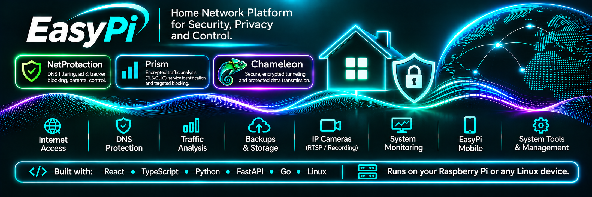
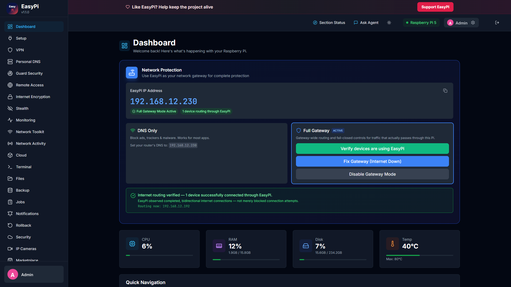
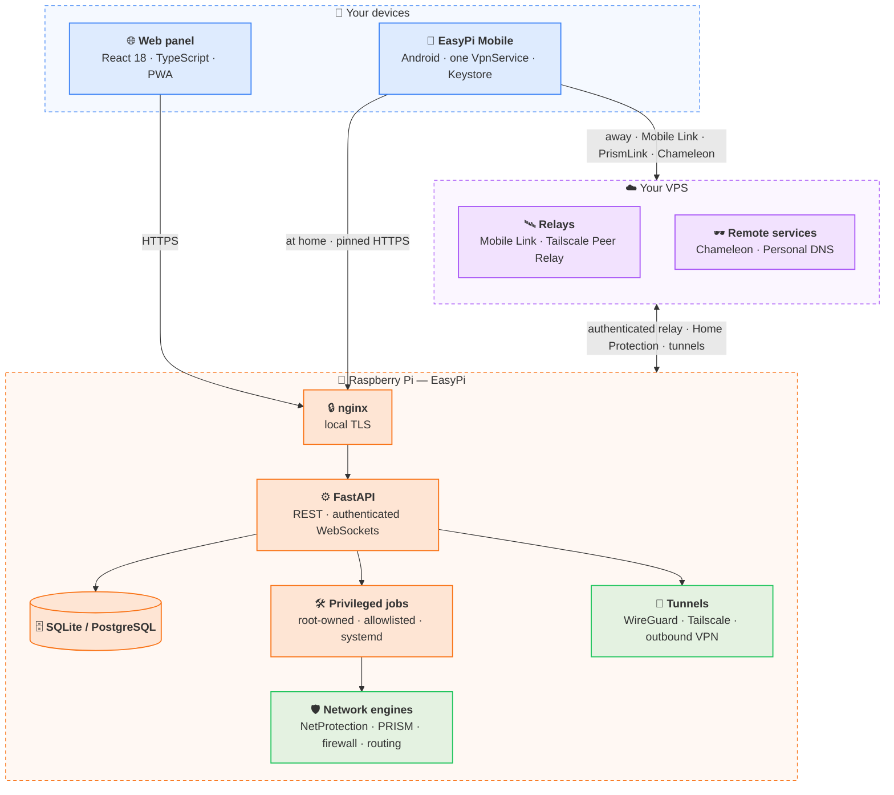

<a id="top"></a>

<p align="center">
  
</p>

<h1 align="center">EasyPi</h1>

<p align="center">
  <strong>Monitor the Pi. Control the network path. Keep the trust boundary visible.</strong><br />
  A self-hosted Raspberry Pi control plane with optional DNS, gateway, VPN, security, storage, and automation tools.
</p>

<p align="center">
  <a href="README.md">English</a> ·
  <a href="README.ru.md">Русский</a> ·
  <a href="README.de.md">Deutsch</a>
</p>

<p align="center">
  <a href="VERSION"></a>
  <a href="#supported-platform"></a>
  <a href="#project-status"></a>
  <a href="LICENSE"></a>
</p>

<p align="center">
  <a href="#screenshots">Screenshots</a> ·
  <a href="#features">Features</a> ·
  <a href="#deployment">Deployment</a> ·
  <a href="#security">Security</a> ·
  <a href="#installation">Installation</a> ·
  <a href="#architecture">Architecture</a> ·
  <a href="#documentation">Docs</a>
</p>

> [!WARNING]
> EasyPi is under active development and can change routing, DNS, firewall rules, and system services. Use it only on infrastructure you own or are authorized to administer. Keep a local recovery path and make a backup before changing gateway or update settings.

<a id="overview"></a>

## ✨ At a glance

| 🖥️ **Observe & operate** | 🛡️ **Protect & classify** | 🌐 **Connect & deploy** |
|:---:|:---:|:---:|
| Live CPU, memory, temperature, disk, and network charts | NetProtection policies, PRISM flow classification, SafeSearch, schedules, and quarantine | WireGuard, Tailscale, Personal DNS, and VPS deployment workflows |

| 🔒 **Route traffic** | 💾 **Protect state** | 🤖 **Run locally** |
|:---:|:---:|:---:|
| Outbound WireGuard, OpenVPN, Outline, and Chameleon for forwarded LAN traffic | Encrypted backups, signed updates, rollback snapshots, files, and PiCloud | Ollama chat and model management on your own hardware |

EasyPi is not automatically in the path of every packet. DNS enforcement requires clients to use the EasyPi resolver. Gateway, per-device routing, kill-switch, and admission policies require the relevant traffic to traverse the Pi.

<a id="screenshots"></a>

## 📸 Screenshots

<p align="center">
  
</p>

<a id="project-status"></a>

## 📌 Project status

| | Current state |
|---|---|
| **Version** | [`1.1.7`](VERSION) |
| **Official binary target** | Raspberry Pi OS Lite 64-bit · Debian Trixie · `aarch64` |
| **Development** | Active; behavior can vary with hardware, upstream routing, IPv6, and third-party services |
| **Binary installation** | The signed-install contract exists, but the independent bootstrap/key distribution channel is not yet complete |
| **Marketplace** | Read-only preview; it is not a package installer |
| **License** | Source available; personal, non-commercial home or lab use only |

<a id="features"></a>

## 🚀 Features

### 🖥️ Dashboard, monitoring, and operations

- Live CPU, memory, temperature, disk, and network values through authenticated WebSockets.
- Responsive charts for recent in-browser samples. They are not a durable history database for every metric.
- Guided installation/configuration flows for **WireGuard**, **Tailscale**, and **Ollama**.
- Jobs, event inbox, signed update workflow, rollback history, and health diagnostics.
- Browser file management, upload/download, editing, and an authenticated admin terminal.
- Installable PWA shell with partial offline navigation; API-backed functions still require the Pi.

### 🛡️ Guard, NetProtection, and PRISM

- Domain and service policies, SafeSearch, schedules, adult-content controls, and opt-in newly registered domain rules.
- Per-device policy, DNS activity, bypass signals, quarantine, threat analytics, and flow classification.
- **Blocked & Allowed** view: every domain the network-wide protection blocked, split into sites someone tried to open and background trackers, each labelled with what blocked it. One click unblocks the exact host or blocks it again; shared zones such as `co.uk` cannot be allowed, and parental controls, schedules, and other device restrictions are never overridden.
- Signed/pinned security-feed handling for reviewed Adult, NRD, and Tor policy inputs.
- Unknown-device admission can fail closed using an observed **MAC+IPv4 pair**.

> [!IMPORTANT]
> Detection and filtering are best effort. Encrypted, novel, spoofed, or out-of-path traffic can evade classification. MAC+IP admission is not cryptographic authentication and is not resistant to a hostile LAN peer cloning both values.

### 🌐 VPN and remote access

- Inbound WireGuard profiles with QR codes for client onboarding.
- Tailscale status, DNS settings, device management, and route approval.
- **Fast Mobile Relay** deploys a Tailscale Peer Relay to a user-controlled Debian/Ubuntu VPS over pinned SSH. It can improve mobile connections when direct NAT traversal fails while EasyPi remains the exit node. Relay hosts use a dedicated `tag:easypi-relay` machine identity, Tailscale shields-up, disabled route/DNS acceptance, and a least-privilege policy that prevents the VPS from becoming a general tailnet member.
- The relay uses UDP 40000 by default, requires Tailscale 1.86 or newer, and receives only end-to-end encrypted WireGuard traffic from devices in the same tailnet. EasyPi generates the exact least-privilege policy grant without overwriting the user's existing Tailscale policy.
- Remote-access workflows that keep administration behind a trusted LAN or authenticated tunnel.
- Provider-dependent functionality remains subject to the installed service, account, and configuration.

### 🔒 Internet Encryption and Stealth

- Outbound **WireGuard**, **OpenVPN**, and **Outline** profiles.
- Whole-network or per-device routing for forwarded LAN traffic.
- IPv4/IPv6 fail-closed controls and tunnel health state.
- **Chameleon** deployment to a user-controlled VPS over verified SSH, designed to resemble ordinary HTTPS traffic.
- The Pi client runs as a dedicated system user in a restricted systemd sandbox with only `CAP_NET_ADMIN`; its PSK configuration remains root-owned and read-only to the client.

> [!NOTE]
> Chameleon encrypts all selected devices' forwarded Internet traffic between the Pi and your VPS. It does not selectively bypass individual phone applications. Local LAN destinations intentionally remain local, and IPv6 traffic without a protected path is blocked instead of sent directly. Traffic created by the Pi itself is outside this selected-device route: this includes Unbound's upstream DNS recursion, which may use the normal WAN unless it is routed separately. Encryption ends at your VPS, as with any VPN, so the VPS operator remains part of the trust boundary. Chameleon's masking makes DPI classification harder but cannot promise anonymity or absolute undetectability.

<details>
<summary><strong>How Chameleon is transported and protected</strong></summary>

- The VPS exposes a real nginx TLS 1.2/1.3 and HTTP/2 frontend on TCP 443. The Chameleon application backend listens only on loopback, runs as an unprivileged service account, and is reached through a PSK-derived private route; unrelated requests receive the static cover site or a normal 404 response.
- The Pi client uses uTLS with a reviewed Chrome 157 desktop/mobile profile derived from the maintained Chrome template. Its TLS identity, HTTP headers, client hints, and language remain coherent for the lifetime of a connection.
- In the standard nginx deployment, authenticated uplink requests and the sequenced downlink stream travel over the real public HTTP/2 connection and a private PSK-derived path. The source also contains a negotiated bidirectional HTTP/2 `CONNECT` carrier for the direct Go frontend, but nginx mode deliberately does not advertise it because its loopback proxy hop uses HTTP/1.1. Neither transport falls back to the direct WAN.
- Every tunnel packet and proxied DNS payload is additionally protected inside TLS with session-bound, direction-separated XChaCha20-Poly1305 keys derived through HKDF-SHA256. A one-time server challenge creates the session; authenticated 64-bit counters and an atomic sliding window reject duplicate and old packets. Request HMACs are bound to the active session, HTTP method and path, and old sessions are rejected after a server restart. The client and server require this protocol version and do not silently fall back to the previous scheme.
- Packet-size buckets, bounded TLS-record shaping, batched acknowledgements, and activity-shaped connection epochs reduce fixed size and timing patterns. Idle periods do not generate synthetic cover traffic.
- IP Shield binds the client to the public IPv4 endpoint and verified certificate without requiring a public cover-domain SNI. Unrelated public requests terminate at nginx and receive the static cover site or a normal 404 without reaching the loopback backend. This does not conceal the VPS IP address or prevent an operator from blocking that address.
- For protected devices, persistent firewall guards, strict DNS routing through `cham0`, IPv6 blocking without a protected route, and the kill-switch prevent a silent direct fallback when the tunnel, resolver, or service fails. QUIC can be blocked so applications retry over the protected TCP path.

Chameleon remains a single-hop, self-hosted tunnel. A network observer can still see a connection to the VPS and may classify long-lived flow behavior; TCP-over-TCP can also amplify delay during packet loss. These limits are separate from the confidentiality and fail-closed guarantees above.

</details>

### 🧅 Personal DNS

- Deploy and manage a DNS service on a compatible VPS over SSH.
- Filtering, health checks, deployment history, and WireGuard client configuration.
- DoH/DoT when a domain and certificate are configured.
- Explicit SSH host-key inspection and trust before deployment.

Personal DNS is a VPS workflow and is separate from the Pi's local NetProtection DNS enforcement.

### 🤖 Local AI with Ollama

- Local chat, conversation sessions, runtime status, model selection, installation, and removal.
- Each question retrieves a bounded set of relevant passages from the packaged EasyPi README, UI help, Chameleon, PRISM, and reviewed security documentation. Runtime data, `.env`, databases, logs, keys, and user files are never indexed.
- Draft explanations and command suggestions without requiring a hosted LLM provider.
- Model availability and performance depend on Pi hardware and the installed Ollama runtime.

The documentation context teaches the model about EasyPi, but it is not live system state. Use Section Status or the diagnostic agent for current service, device, and configuration facts. Always review suggested commands before running them.

### 🩺 Diagnostic agent

- A modular diagnostic gateway collects bounded facts from services, networking, storage, updates, backups, cameras, and other EasyPi subsystems.
- Read-only probes can explain current state and combine several independent checks in one request.
- Suggested state-changing actions are allowlisted and are offered only when their evidence is current and internally consistent.
- Actions marked as sensitive require an authenticated administrator and an explicit confirmation token before execution.

The diagnostic agent is separate from Ollama chat. It can use deterministic probes and action contracts without treating generated text as authority to run a command.

### 💾 Backups, files, and encryption

- Manually started encrypted full-state or configuration backups.
- Backup status, cancellation, download, restore preview, restore, and deletion.
- Passphrase-protected `.epikey` recovery packages for restoring encrypted backups on a replacement EasyPi host.
- PiCloud client-side **EPEC v2** encryption using AES-256-GCM and PBKDF2-SHA-256 with 600,000 iterations.
- Chunked encryption, encrypted metadata, size padding, and legacy EPEC v1 decryption.
- PiCloud file search, tags, duplicate discovery, bulk operations, and share links with optional passwords and expiration times. Deleting a link revokes its token, and a link is bound to the exact file that was shared rather than a reusable path.

#### Sending files to PiCloud

| Method | Maximum incoming file | When to use it |
|---|---:|---|
| **Telegram bot** | **20 MB** | Small files sent to the configured EasyPi bot |
| **Tailscale Taildrop** | No fixed EasyPi per-file limit | **All files larger than 20 MB**; the practical limit is available storage |

The 20 MB Telegram limit comes from the standard Bot API `getFile` download limit. Increasing EasyPi's local file-size setting cannot raise that platform limit. See the [Telegram Bot API documentation](https://core.telegram.org/bots/api#getfile).

For larger files, enable **Send Files** in the Tailscale admin settings, sign in to Tailscale with the same personal account on EasyPi and the sending device, and keep the EasyPi node untagged. On Android, select the file, tap **Share**, choose **Tailscale**, and select this EasyPi. Regardless of whether a file arrives through Telegram or Taildrop, PiCloud sorts it into **Photos**, **Videos**, **Documents**, **Music**, **Encrypted**, or **Files** according to its type. The browser does not need to remain open.

All PiCloud receive paths and file copies preserve **5 GiB** of free space for system operation. Taildrop also requires enough temporary room for an atomic import. If there is not enough space, browser and Telegram uploads and Cloud copies are rejected with **Not enough disk space**; a Taildrop file remains waiting, and existing PiCloud files are never deleted automatically.

“Full” means selected EasyPi application data and managed system configuration, not a block-level SD-card image. See [Backup reality](#backup-reality) for the recovery boundary.

### 💻 Terminal, cameras, and notifications

- Authenticated, admin-only interactive PTY over WebSocket with session metadata and command audit summaries.
- RTSP camera management, live view, snapshots, FFmpeg recording, storage/retention controls, and recording playback.
- Capability-dependent PTZ control: pan, tilt, zoom, stop, home position, and saved presets when the camera and selected adapter support them.
- In-app event inbox, Web Push, SMTP/email infrastructure, and Telegram integration.

Terminal session playback and time-range extraction from camera recordings are not part of this release; complete recordings can be played or downloaded. Camera support depends on the device, codec, network, FFmpeg, and go2rtc configuration. Notification delivery requires the relevant provider configuration.

### 🛍️ Marketplace

The Marketplace is intentionally honest: it is a **read-only preview of planned package ideas**. It does not currently have a populated production registry or an installation lifecycle.

<a id="deployment"></a>

## 🧭 Deployment modes

| Mode | What it enables | Boundary |
|---|---|---|
| **🖥️ Management only** | Dashboard, services, jobs, files, terminal, backups, cameras, and local AI | Does not filter client traffic by itself |
| **🧠 DNS enforcement** | Domain rules, SafeSearch, DNS analytics, and DNS-based service controls | Clients must use EasyPi as their resolver |
| **🧭 Full Gateway** | NAT/forwarding, per-device routing, kill-switches, admission, and stronger fail-closed policy | EasyPi must be the real IPv4/IPv6 forwarding path |
| **☁️ Remote / VPS** | WireGuard/Tailscale remote access, Personal DNS, and Stealth | Requires external services, credentials, and SSH host-key verification where applicable |

> [!TIP]
> Before enabling Full Gateway mode, prepare physical console access or a router-level recovery path. EasyPi cannot filter traffic that physically travels through another router.

<a id="security"></a>

## 🔐 Security, privacy, and limitations

| Boundary | What it means |
|---|---|
| **Authentication** | First launch uses a setup/recovery token and has no default credentials. Sessions use a 30-minute access token and a 7-day refresh token in `HttpOnly`, `SameSite` cookies. TOTP 2FA, CSRF checks, session revocation, and rate limiting are implemented. |
| **Admin surface** | Do not expose the panel directly to the public Internet. Prefer a trusted LAN, WireGuard, or Tailscale. Terminal, restore, routing, firewall, and updater access are privileged operations. |
| **Traffic path** | DNS policy requires EasyPi DNS. Gateway enforcement requires traffic to traverse the Pi. Enforced IPv6 policy requires EasyPi to be the IPv6 gateway or IPv6 to be disabled upstream. |
| **Device identity** | Observed MAC+IP admission helps quarantine accidental or new devices on a trusted LAN; it is spoofable and is not strong device authentication. |
| **Privacy** | EasyPi can intercept, classify, block, redirect, and log DNS/network metadata. Inform network users where required by law. A VPN provider or VPS becomes another trust point. |
| **Sensitive state** | Recovery tokens, backups, VPN profiles, SSH material, camera recordings, and logs can contain sensitive data. Store exports securely and keep the recovery token offline. |

Read the full [network security model](docs/NETWORK_SECURITY_MODEL.md), [signed security-feed design](docs/SIGNED_SECURITY_FEEDS.md), and [EULA](EULA.txt) before using enforcement features.

<a id="requirements"></a>
<a id="supported-platform"></a>

## 🧰 Requirements

| Requirement | Supported / recommended state |
|---|---|
| **OS** | Raspberry Pi OS Lite 64-bit based on Debian Trixie |
| **Architecture** | ARM64 (`aarch64`) |
| **Hardware** | Documented baseline: Raspberry Pi 3B+; Raspberry Pi 4 with 4 GB RAM or better recommended |
| **Storage** | 32 GB or more recommended; allow extra space for backups, AI models, and camera recordings |
| **Network** | Wired Ethernet recommended for gateway use; Internet access required during installation and for external integrations |
| **Recovery access** | Local console or SSH plus `sudo` |
| **Optional infrastructure** | VPS for Personal DNS/Stealth; provider accounts or credentials for Tailscale, email, Telegram, VPN, and other integrations |

The installer checks `aarch64`, but it does not certify the Pi model, RAM, or storage capacity.

<a id="installation"></a>

## 📦 Installation

### Quick install

On Raspberry Pi OS Lite 64-bit (Trixie), as a user with `sudo`:

```bash
wget https://github.com/NewNetGuard/EasyPi/releases/latest/download/easypi-full-aarch64-trixie.tar.gz &&
wget https://github.com/NewNetGuard/EasyPi/releases/latest/download/easypi-full-aarch64-trixie.tar.gz.sig &&
wget https://raw.githubusercontent.com/NewNetGuard/EasyPi/main/scripts/maintenance/update_signing_key.pub &&
openssl dgst -sha256 -verify update_signing_key.pub -signature easypi-full-aarch64-trixie.tar.gz.sig easypi-full-aarch64-trixie.tar.gz &&
sudo mkdir -p /opt/EasyPi &&
sudo tar -xzf easypi-full-aarch64-trixie.tar.gz -C /opt/EasyPi &&
sudo /opt/EasyPi/install.sh --binary
```

The fourth command checks the archive's detached signature with the EasyPi release key and must print `Verified OK`; otherwise the chain stops and nothing is installed. The key comes from this repository, so the check proves that the archive was signed with the EasyPi release key but does not protect against a compromised GitHub account. A stricter installation through an independent APT channel is planned; see below. When the installer finishes, continue with [First access after a verified install](#first-access-after-a-verified-install).

### Independent APT channel (planned)

> [!CAUTION]
> Never run `install.sh` from an archive whose signature you have not verified. A checksum detects corruption but does not authenticate the publisher.

A stricter flow is prepared but not yet published. [`scripts/release/prepare_bootstrap_deb.sh`](scripts/release/prepare_bootstrap_deb.sh) builds the `easypi-release-bootstrap` package with the `easypi-install-release` installer and the release key `/usr/share/keyrings/easypi-release.pub`. It is meant to be delivered through a separately signed APT repository hosted outside GitHub, so that replacing an installation would require compromising both channels. That repository does not exist yet; until it does, the quick install above is the supported method.

Once the channel is published, installation becomes (see the [binary release template](distribution/public_repo_template/README.md)):

```bash
easypi-install-release \
  --archive-url "https://github.com/NewNetGuard/EasyPi/releases/latest/download/easypi-full-aarch64-trixie.tar.gz" \
  --signature-url "https://github.com/NewNetGuard/EasyPi/releases/latest/download/easypi-full-aarch64-trixie.tar.gz.sig"
```

Never take the bootstrap package or its trust key from the same channel as the archive.

<details>
<summary><strong>Release validation and remaining boundary</strong></summary>

- The release validator checks archive paths, member types, required files, manifest coverage and hashes, semantic version, architecture, Debian codename, and declared glibc compatibility before installation.
- The installer reads current build metadata from `BUILD_INFO` and retains a limited `VERSION` fallback for older packages. The official artifact contract is Trixie on `aarch64`.
- Signed downloads follow at most five HTTPS redirects. Every hop is revalidated, resolved only to global addresses, and pinned for the transfer; the detached signature is still mandatory.
- EasyPi builds fresh Chameleon binaries from reviewed source during installation and may download a pinned Go toolchain. Allow extra time, storage, and network access.
- Static and fixture tests do not replace a clean-device installation, reboot/rollback exercise, and network-mode test on real supported Raspberry Pi hardware.

</details>

Release maintainers should build with [`build_all.sh`](build_all.sh), prepare the signed public bundle with [`scripts/release/prepare_public_repo.sh`](scripts/release/prepare_public_repo.sh), and build the independent bootstrap package with [`scripts/release/prepare_bootstrap_deb.sh`](scripts/release/prepare_bootstrap_deb.sh). The private signing key must never be stored in the repository or release channel.

For a personal build from a clone of the published source repository, run `bash backend/packaging/build_binary.sh --clean` from a clean, committed Git checkout on the target Linux architecture. This builds both the frontend and the native backend and creates the full archive under `.build/`. A Raspberry Pi binary requires an ARM64 build environment; running the script on Windows or Linux x86-64 does not produce an ARM64 binary. Install Git, Node.js/npm matching `frontend/package.json`, Python 3 with venv support, and the required native build tools first; dependency downloads require internet access. A GitHub ZIP download has no `.git` directory: use `git clone`, or initialize and commit the complete source locally. No server address or private signing key is needed to compile. Signing is a separate step using your own key kept outside the repository.

### First access after a verified install

1. **Open EasyPi.** Use the address printed at the end of the installer:

   ```text
   https://<pi-address>/
   https://easypi.local/
   ```

   `easypi.local` can take 30–90 seconds to appear through mDNS; the IP address works immediately.
2. **Accept or trust the certificate.** EasyPi uses its own local certificate authority, so the browser warns on the first visit. Check that the address belongs to your Pi, then either continue once or remove the warning for good by importing `https://<pi-address>/ca.pem` as a trusted root certificate. The installer prints the steps for Windows, macOS, Linux, Android and iOS.
3. **Create the administrator.** The first page is **EasyPi Setup**; press **Continue**. On **Create Admin Account** choose a username and a strong password and paste the **setup token** printed at the end of the installer. There are no default credentials. The same token is your recovery token: store it securely and offline.
4. **Choose how your network uses EasyPi** in the **Network Protection** card on the dashboard:
   - **DNS Only** — in your router's DHCP settings, set the DNS server to the EasyPi address. Domain filtering, parental controls and DNS statistics start working for every device.
   - **Full Gateway** — in your router's DHCP settings, set both the gateway and the DNS server to the EasyPi address and save. Then press **I configured the router — Enable Gateway** in the card. When it shows **Full Gateway Mode Active**, all traffic passes through EasyPi. If devices lose Internet access, press **Fix Gateway (Internet Down)**; **Disable Gateway Mode** returns to DNS only.

   Devices pick up the new settings when they reconnect to the network or renew their DHCP lease.
5. **Follow the Getting Started card** on the dashboard for the remaining steps, such as protection profiles for your devices.

<a id="operations"></a>

## ♻️ Operations

<details>
<summary><strong>🔄 Signed updates and rollback</strong></summary>

The Setup page accepts a local release archive or HTTPS URL together with a mandatory detached signature. Its root-owned `scripts/maintenance/apply_update.sh` path verifies the release before extraction, refuses downgrades by default, snapshots the current code/database state, applies the update, and health-checks the backend. A failed apply triggers rollback; reboot recovery covers an interrupted update.

The repository-root `update.sh` is a compatibility entry point for the same hardened updater. It translates the legacy command-line options and delegates signature verification, snapshotting, health checks, reboot recovery, and rollback to `scripts/maintenance/apply_update.sh`; it refuses custom installation targets. The explicit `--skip-restart` option only stages verified files and therefore intentionally skips the restart/health gate.

For PostgreSQL, the updater also takes a database dump before applying the release and restores it during rollback. These internal dumps are stored with root-only access in the update snapshot directory; they are not encrypted `.epibak` exports. Keep a separately stored encrypted backup for recovery.

</details>

<a id="backup-reality"></a>

<details>
<summary><strong>💾 Backup reality</strong></summary>

The Backup page starts full-state or configuration-only backups manually. “Full” includes selected EasyPi data, `.env`, and managed system configuration, while excluding installer jobs, the NetProtection vault, the VAPID private key, and downloaded adult-feed files.

SQLite is the default database and its local files are included within the documented snapshot boundary. When PostgreSQL is configured, both backup types create a validated custom-format `pg_dump` inside the encrypted `.epibak`; restore uses `pg_restore` with ownership and privilege replay disabled, a single transaction, and automatic database rollback from the pre-restore safety snapshot. PostgreSQL client tools are installed with EasyPi. If the tools, credentials, dump, or archive/database metadata are missing or invalid, backup or restore fails closed instead of reporting an incomplete copy as successful.

PostgreSQL restore selects its destination from `DATABASE_URL` in the archived `.env`. The destination database and login role must already exist and be reachable with those credentials; recovery does not provision a PostgreSQL server, database, or roles. Older PostgreSQL backups without a database dump are rejected before state-writing services are stopped.

Each `.epibak` is authenticated and encrypted with the host-local key at `/var/lib/easypi/backup/backup.key`. For recovery on another EasyPi host, export a passphrase-protected `.epikey` package from the Backup page and store it separately from both the `.epibak` files and its passphrase. On the replacement host, import the `.epikey` first and then use **Import Backup Archive** to authenticate, validate, and register the corresponding `.epibak` without overwriting an existing archive. Importing the package adds the old decryption key without replacing the new host's active key, so backups from both hosts remain usable. A downloaded `.epibak` alone is still not a complete recovery set. Scheduled automatic backups are not a supported workflow today.

Restore runs as a single detached systemd job. EasyPi quiesces state-writing services, creates an encrypted pre-restore safety snapshot, applies only allowlisted paths, restarts the services, and requires the backend health check to pass. A failed apply or startup automatically reapplies the safety snapshot. If reapplying that snapshot fails, the recorded services remain stopped and the snapshot is retained for manual recovery. The final result is written atomically to a root-owned status file; restores started from Rollback Center are also reconciled into its history.

</details>

<details>
<summary><strong>🧹 Safe uninstall</strong></summary>

The binary release includes a prefix-validating [`uninstall.sh`](uninstall.sh). It refuses to race an active signed update, package operation, backup, or restore. The default command then disables EasyPi services, clears EasyPi-owned runtime chains and tagged UFW rules, and removes product-owned host integration while retaining the installation and persistent state for recovery:

```bash
sudo /opt/EasyPi/uninstall.sh
```

Permanent deletion is deliberately separate and non-interactive. Export required backups and recovery keys first; then pass both destructive flags:

```bash
sudo /opt/EasyPi/uninstall.sh --purge --yes
```

Purge accepts only a canonical EasyPi-shaped prefix, verifies the installed tree and root-owned directory boundary, and then removes the installation plus EasyPi-owned persistent state.

Uninstall deliberately preserves global UFW defaults and every untagged administrator rule. Rules left by older EasyPi versions that cannot be distinguished safely from administrator policy are also retained instead of being guessed at.

</details>

<details>
<summary><strong>🩺 Basic diagnostics</strong></summary>

```bash
sudo systemctl status easypi-backend.service --no-pager -l
sudo journalctl -u easypi-backend.service -n 200 --no-pager
sudo systemctl status easypi-netprotection.service nginx --no-pager -l
sudo journalctl -u easypi-netprotection.service -n 200 --no-pager
```

</details>

<a id="architecture"></a>

## 🏗️ Architecture

EasyPi runs in up to three places: the devices you manage it from, the Raspberry Pi itself, and an optional VPS that you control.



| Where | Component | Details |
|---|---|---|
| 👤 **Your devices** | **Web panel** | React 18, TypeScript, Vite, Tailwind CSS, TanStack Query, Zustand, xterm.js, Recharts, service worker |
|  | **EasyPi Mobile** | QR pairing, Android Keystore credentials, pinned HTTPS Mobile Link, one `VpnService`, PrismLink home Protection, optional Chameleon routing, gallery, sharing, and photo/video backup |
| 🍓 **Raspberry Pi** | **Application** | nginx with local TLS; FastAPI, REST, authenticated WebSockets, SQLAlchemy/Alembic; SQLite by default with PostgreSQL runtime support and encrypted `pg_dump`/`pg_restore` backup integration |
|  | **Privileged boundary** | Root-owned allowlisted job scripts and systemd units for update, routing, capture, and service management |
|  | **Network engines** | NetProtection DNS/policy engine, PRISM classification, iptables/UFW, WireGuard/Tailscale, outbound VPN routing |
| ☁️ **Your VPS** | **Remote services** | Verified SSH deployment of Personal DNS, the Mobile Link relay, a Tailscale Peer Relay, and the Go-based Chameleon server; the Pi runs the Chameleon client |

<a id="development"></a>

## 🧪 Development and verification

The repository is the source of truth. Preserve existing uncommitted work when making changes.

<details>
<summary><strong>CI-equivalent checks</strong></summary>

CI currently uses Python 3.11, Node.js 22, and Go 1.25.13.

```bash
# Backend and security gate
python3.11 -m venv .venv
. .venv/bin/activate
python -m pip install --require-hashes -r backend/requirements-dev.lock
python -m ruff check backend easypi_netprotection prism_dpi scripts tests
git ls-files -z '*.sh' | xargs -0 bash -n
PYTHONPATH=backend:. python -m pytest -q
bash scripts/release/prepare_bootstrap_deb.sh --out .build/ci-bootstrap

# Frontend
cd frontend
npm ci
npm run lint
npm run type-check
npm audit --audit-level=high
npm run build

# Chameleon
cd ../chameleon
bash build.sh
go test ./...
```

CI also runs `pip-audit`, `npm audit --audit-level=high`, and `govulncheck`.

</details>

The [PostgreSQL integration cycle](tests/integration/postgresql_backup_cycle.py) uses real `pg_dump`/`pg_restore`, an encrypted `.epibak`, and a temporary systemd health service. It checks restored data, recovery from a safety dump after a deliberately failed health check, and rejection of a truncated dump. `POSTGRESQL_BACKUP_E2E=PASS` covers this helper-level cycle: the test itself invokes recovery. The production restore job, signed updater, and reboot recovery require separate end-to-end runs on a dedicated Linux test host.

<a id="documentation"></a>

## 📚 Documentation

| Document | Purpose |
|---|---|
| [Network security model](docs/NETWORK_SECURITY_MODEL.md) | Traffic-path, IPv6, and device-admission boundaries |
| [Signed security feeds](docs/SIGNED_SECURITY_FEEDS.md) | Feed signing, pinning, rollback protection, and failure behavior |
| [Binary release template](distribution/public_repo_template/README.md) | Intended signed bootstrap contract for end users |
| [License](LICENSE) · [EULA](EULA.txt) | Usage rights, operational risk, and user responsibilities |
| [Third-party notices](THIRD_PARTY_LICENSES.md) | Licenses for bundled and dependent components |

The old screenshot gallery is not linked because its image files are absent. Restore it only with current screenshots reviewed for credentials, addresses, tokens, and other private data.

<a id="license"></a>

## 📜 License and contributions

EasyPi is **source available**, not OSI open source. The [EasyPi Source Available License 1.3](LICENSE) permits anyone to inspect and audit the code, build it for personal non-commercial home or lab use, and modify it privately. Commercial use, independent redistribution, public mirrors, repackaging, hosted or managed services, and offering EasyPi as SaaS, VPN, DNS, relay, or another third-party service require prior written permission.

**Chameleon.** The Chameleon 1.1.5 transport bundled under `chameleon/` is distributed under its own license in [`chameleon/LICENSE`](chameleon/LICENSE). The standalone Chameleon project, version 1.2.1, is distributed separately under the Mozilla Public License 2.0 (MPL-2.0). MPL-2.0 does not apply to the rest of EasyPi, which remains under the EasyPi Source Available License 1.3.

Contributions are welcome through [GitHub Issues and pull requests](https://github.com/NewNetGuard/EasyPi). You may fork the repository on GitHub and publish source code changes in your fork for non-commercial purposes, provided the fork keeps the license and all notices and is not presented as an official release. Forks may contain source code only: built binaries, installers, release archives, and container images may not be distributed, including through a fork's releases. These permissions do not grant commercial deployment or general redistribution rights. Personal household use and private builds signed with your own key are permitted. See [LICENSE](LICENSE) for the complete terms.

<p align="center">
  <sub>EasyPi v1.1.7 · Raspberry Pi OS Trixie · Active development</sub><br />
  <a href="#top">Back to top</a>
</p>
