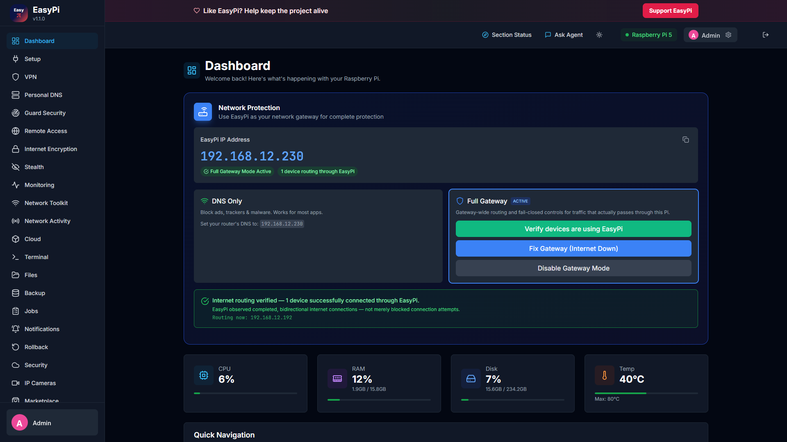
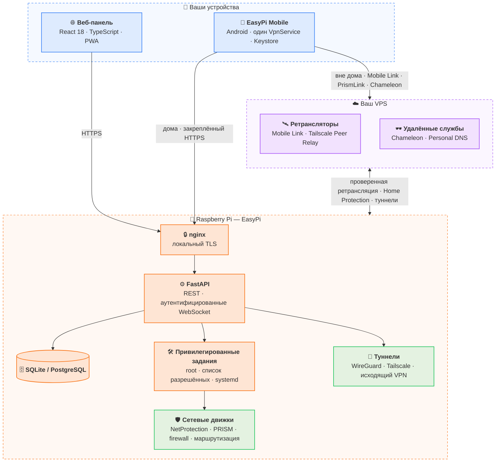

<a id="top"></a>

<p align="center">
  
</p>

<h1 align="center">EasyPi</h1>

<p align="center">
  <strong>Наблюдайте за Pi. Управляйте сетевым путём. Не теряйте из виду границы доверия.</strong><br />
  Самостоятельно размещаемая панель управления Raspberry Pi с дополнительными инструментами DNS, шлюза, VPN, безопасности, хранения данных и автоматизации.
</p>

<p align="center">
  <a href="README.md">English</a> ·
  <a href="README.ru.md">Русский</a> ·
  <a href="README.de.md">Deutsch</a>
</p>

<p align="center">
  <a href="VERSION"></a>
  <a href="#supported-platform"></a>
  <a href="#project-status"></a>
  <a href="LICENSE"></a>
</p>

<p align="center">
  <a href="#screenshots">Скриншоты</a> ·
  <a href="#features">Возможности</a> ·
  <a href="#deployment">Развёртывание</a> ·
  <a href="#security">Безопасность</a> ·
  <a href="#installation">Установка</a> ·
  <a href="#architecture">Архитектура</a> ·
  <a href="#documentation">Документация</a>
</p>

> [!WARNING]
> EasyPi находится в активной разработке и может изменять маршрутизацию, DNS, правила межсетевого экрана и системные службы. Используйте его только в собственной инфраструктуре или там, где у вас есть разрешение на администрирование. Сохраняйте локальный способ восстановления и создавайте резервную копию перед изменением настроек шлюза или обновления.

<a id="overview"></a>

## ✨ Краткий обзор

| 🖥️ **Наблюдение и управление** | 🛡️ **Защита и классификация** | 🌐 **Подключение и развёртывание** |
|:---:|:---:|:---:|
| Графики процессора, памяти, температуры, диска и сети в реальном времени | Политики NetProtection, классификация потоков PRISM, SafeSearch, расписания и карантин | Сценарии WireGuard, Tailscale, Personal DNS и развёртывания на VPS |

| 🔒 **Маршрутизация трафика** | 💾 **Защита состояния** | 🤖 **Локальный запуск** |
|:---:|:---:|:---:|
| Исходящие WireGuard, OpenVPN, Outline и Chameleon для перенаправляемого LAN-трафика | Зашифрованные резервные копии, подписанные обновления, снимки отката, файлы и PiCloud | Чат Ollama и управление моделями на собственном оборудовании |

EasyPi не оказывается автоматически на пути каждого пакета. Для принудительного DNS-контроля клиенты должны использовать резолвер EasyPi. Политики шлюза, маршрутизации по устройствам, аварийного отключения и допуска действуют только тогда, когда соответствующий трафик проходит через Pi.

<a id="screenshots"></a>

## 📸 Скриншоты

<p align="center">
  
</p>

<a id="project-status"></a>

## 📌 Состояние проекта

| | Текущее состояние |
|---|---|
| **Версия** | [`1.1.10`](VERSION) |
| **Официальная цель бинарной сборки** | Raspberry Pi OS Lite 64-bit · Debian Trixie · `aarch64` |
| **Разработка** | Активная; поведение может зависеть от оборудования, вышестоящей маршрутизации, IPv6 и сторонних служб |
| **Бинарная установка** | Контракт подписанной установки существует, но независимый канал доставки загрузчика и ключа ещё не завершён |
| **Marketplace** | Предварительный просмотр только для чтения; это не установщик пакетов |
| **Лицензия** | Source available; только личное некоммерческое использование дома или в лаборатории |

<a id="features"></a>

## 🚀 Возможности

### 🖥️ Панель, мониторинг и эксплуатация

- Текущие значения загрузки процессора, памяти, температуры, диска и сети через аутентифицированные WebSocket-соединения.
- Адаптивные графики последних собранных в браузере образцов. Они не являются долговременной базой истории для каждой метрики.
- Пошаговые сценарии установки и настройки **WireGuard**, **Tailscale** и **Ollama**.
- Задания, лента событий, сценарий подписанного обновления, история откатов и диагностика состояния.
- Управление файлами в браузере, загрузка и скачивание, редактирование и аутентифицированный административный терминал.
- Устанавливаемая PWA-оболочка с частичной офлайн-навигацией; функциям, использующим API, по-прежнему требуется Pi.

### 🛡️ Guard, NetProtection и PRISM

- Политики доменов и сервисов, SafeSearch, расписания, контроль контента для взрослых и опциональные правила для недавно зарегистрированных доменов.
- Политики по устройствам, DNS-активность, сигналы обхода, карантин, аналитика угроз и классификация потоков.
- Вкладка **Blocked & Allowed**: всё, что заблокировала общесетевая защита, в двух списках — сайты, которые пытались открыть, и фоновые трекеры; у каждой записи указано, что её заблокировало. Одним нажатием можно разблокировать именно этот адрес или снова заблокировать его; общие зоны вроде `co.uk` разрешить нельзя, а родительский контроль, расписания и другие ограничения устройств никогда не обходятся.
- Обработка подписанных и закреплённых security feeds для проверенных входных данных Adult, NRD и Tor.
- Допуск неизвестных устройств может работать в режиме fail-closed по наблюдаемой **паре MAC+IPv4**.

> [!IMPORTANT]
> Обнаружение и фильтрация работают по принципу максимальных усилий. Зашифрованный, новый, подменённый или проходящий в обход трафик может избежать классификации. Допуск по MAC+IP не является криптографической аутентификацией и не защищает от злоумышленника в LAN, который клонирует оба значения.

### 🌐 VPN и удалённый доступ

- Входящие профили WireGuard с QR-кодами для подключения клиентов.
- Состояние Tailscale, настройки DNS, управление устройствами и подтверждение маршрутов.
- Сценарии удалённого доступа, при которых администрирование остаётся за доверенной LAN или аутентифицированным туннелем.
- Возможности, зависящие от провайдера, определяются установленной службой, учётной записью и конфигурацией.

### 🔒 Internet Encryption и Stealth

- Исходящие профили **WireGuard**, **OpenVPN** и **Outline**.
- Маршрутизация всей сети или отдельных устройств для перенаправляемого LAN-трафика.
- Fail-closed-контроль IPv4/IPv6 и состояние туннеля.
- Развёртывание **Chameleon** на управляемом пользователем VPS через проверенное SSH-соединение, спроектированное так, чтобы трафик напоминал обычный HTTPS.
- Клиент на Pi работает от отдельного системного пользователя в ограниченной песочнице systemd только с `CAP_NET_ADMIN`; конфигурация с PSK принадлежит root и доступна клиенту лишь для чтения.

> [!NOTE]
> Chameleon шифрует весь перенаправляемый интернет-трафик выбранных устройств на участке между Pi и вашим VPS. Отдельные приложения телефона не обходят туннель выборочно. Обращения к устройствам локальной сети намеренно остаются внутри LAN, а IPv6 без защищённого маршрута блокируется и не выпускается напрямую. Собственные соединения Pi не относятся к маршруту выбранного устройства: сюда входят внешние DNS-запросы Unbound, которые могут использовать обычный WAN, если для них отдельно не настроен туннельный маршрут. Как и у любого VPN, шифрование заканчивается на вашем VPS, поэтому оператор VPS остаётся частью доверенной границы. Маскировка Chameleon усложняет распознавание туннеля средствами DPI, но не обещает анонимность или абсолютную неразличимость.

<details>
<summary><strong>Как устроены транспорт и защита Chameleon</strong></summary>

- На VPS настоящий nginx принимает TLS 1.2/1.3 и HTTP/2 на TCP-порту 443. Backend Chameleon слушает только loopback, работает от непривилегированной системной учётной записи и доступен через закрытый маршрут, производный от PSK; посторонние запросы получают статическую страницу прикрытия или обычный ответ 404.
- Клиент на Pi использует uTLS с проверенным профилем Chrome 157 для настольных и мобильных устройств, созданным на основе поддерживаемого шаблона Chrome. TLS-идентичность, HTTP-заголовки, Client Hints и язык остаются согласованными в течение всего соединения.
- В стандартной конфигурации с nginx аутентифицированные исходящие запросы и нумерованный входящий поток проходят через настоящее публичное соединение HTTP/2 и закрытый маршрут, производный от PSK. В исходном коде также есть согласуемый двунаправленный HTTP/2 `CONNECT` для прямого Go-frontend, но режим nginx намеренно его не объявляет, поскольку loopback-проксирование использует HTTP/1.1. Ни один из транспортов не переходит на прямой WAN.
- Каждый туннельный пакет и DNS-пакет внутри TLS дополнительно защищён XChaCha20-Poly1305 с привязанными к сессии раздельными ключами направлений, полученными через HKDF-SHA256. Сессию создаёт одноразовый challenge сервера; аутентифицированные 64-битные счётчики и атомарное скользящее окно отклоняют дубликаты и старые пакеты. HMAC запросов привязан к активной сессии, HTTP-методу и пути, а после перезапуска сервера прежние сессии отвергаются. Клиент и сервер требуют эту версию протокола и не выполняют скрытый откат к прежней схеме.
- Выравнивание размеров по наборам, ограниченное изменение размеров TLS-record, пакетирование подтверждений и зависящие от активности эпохи соединения уменьшают постоянные признаки размера и времени. В периоды простоя искусственный фоновый трафик не создаётся.
- IP Shield привязывает клиент к публичному IPv4-адресу и проверенному сертификату без обязательного публичного SNI домена прикрытия. Посторонние публичные запросы завершаются на nginx и получают статическую страницу прикрытия или обычный ответ 404, не достигая loopback-backend. Это не скрывает IP-адрес VPS и не мешает оператору заблокировать сам адрес.
- Для защищённых устройств постоянные правила firewall, строгая маршрутизация DNS через `cham0`, блокировка IPv6 без защищённого маршрута и kill-switch исключают незаметный прямой fallback при сбое туннеля, resolver или службы. QUIC можно блокировать, чтобы приложения повторяли соединение через защищённый TCP-путь.

Chameleon остаётся однопереходным self-hosted-туннелем. Наблюдатель сети всё ещё видит соединение с VPS и может классифицировать поведение длительного потока; TCP поверх TCP также может усиливать задержки при потерях пакетов. Эти ограничения не отменяют описанные выше шифрование и fail-closed-защиту.

</details>

### 🧅 Personal DNS

- Развёртывание DNS-службы на совместимом VPS через SSH и управление ею.
- Фильтрация, проверки состояния, история развёртываний и конфигурация клиента WireGuard.
- DoH/DoT при настроенных домене и сертификате.
- Явная проверка SSH host key и подтверждение доверия перед развёртыванием.

Personal DNS — это сценарий для VPS, отдельный от локального DNS-контроля NetProtection на Pi.

### 🤖 Локальный AI с Ollama

- Локальный чат, сеансы диалогов, состояние среды выполнения, выбор, установка и удаление моделей.
- Для каждого вопроса локально выбирается ограниченный набор подходящих фрагментов из README EasyPi, справки интерфейса и проверенной документации Chameleon, PRISM и безопасности. Данные среды выполнения, `.env`, базы данных, журналы, ключи и пользовательские файлы никогда не индексируются.
- Черновики объяснений и предложений команд без необходимости использовать облачного LLM-провайдера.
- Доступность моделей и производительность зависят от оборудования Pi и установленной среды Ollama.

Документация даёт модели знания об EasyPi, но не сообщает текущее состояние системы. Для актуальных данных о службах, устройствах и конфигурации используйте Section Status или диагностический агент. Всегда проверяйте предложенные команды перед запуском.

### 🩺 Диагностический агент

- Модульный диагностический шлюз собирает ограниченный набор фактов о службах, сети, хранилище, обновлениях, резервных копиях, камерах и других подсистемах EasyPi.
- Проверки только для чтения могут объяснять текущее состояние и объединять несколько независимых диагностик в одном запросе.
- Действия, изменяющие состояние, выбираются только из разрешённого списка и предлагаются лишь при актуальных и непротиворечивых исходных данных.
- Для чувствительных действий требуются аутентифицированный администратор и явный токен подтверждения.

Диагностический агент работает отдельно от чата Ollama. Он может использовать детерминированные проверки и контракты действий, не считая сгенерированный текст разрешением на запуск команды.

### 💾 Резервные копии, файлы и шифрование

- Запускаемые вручную зашифрованные резервные копии полного состояния или конфигурации.
- Состояние резервного копирования, отмена, скачивание, предварительный просмотр восстановления, восстановление и удаление.
- Защищённые парольной фразой пакеты `.epikey` для восстановления зашифрованных копий на другом хосте EasyPi.
- Клиентское шифрование **EPEC v2** в PiCloud на основе AES-256-GCM и PBKDF2-SHA-256 с 600 000 итераций.
- Блочное шифрование, зашифрованные метаданные, дополнение размера и расшифровка устаревшего формата EPEC v1.
- Поиск файлов PiCloud, теги, поиск дубликатов, массовые операции и общие ссылки с необязательным паролем и сроком действия. Удаление ссылки отзывает её токен, а сама ссылка привязана к конкретному опубликованному файлу, а не к повторно используемому пути.

#### Передача файлов в PiCloud

| Способ | Максимальный входящий файл | Когда использовать |
|---|---:|---|
| **Telegram-бот** | **20 МБ** | Небольшие файлы, отправленные настроенному боту EasyPi |
| **Tailscale Taildrop** | В EasyPi нет фиксированного лимита на один файл | **Все файлы больше 20 МБ**; фактический предел зависит от свободного места |

Ограничение Telegram в 20 МБ задаёт стандартный Bot API для скачивания входящих файлов через `getFile`. Увеличение локального лимита в EasyPi не может повысить этот предел платформы. См. [документацию Telegram Bot API](https://core.telegram.org/bots/api#getfile).

Для файлов большего размера включите **Send Files** в настройках администратора Tailscale, войдите в Tailscale под одной личной учётной записью на EasyPi и отправляющем устройстве и не назначайте узлу EasyPi тег. На Android выберите файл, нажмите **Поделиться**, выберите **Tailscale**, а затем этот EasyPi. Независимо от того, пришёл файл через Telegram или Taildrop, PiCloud распределяет его по типу в **Photos**, **Videos**, **Documents**, **Music**, **Encrypted** или **Files**. Держать браузер открытым не требуется.

Все способы приёма файлов в PiCloud и копирование сохраняют **5 ГиБ** свободного места для работы системы. Taildrop дополнительно требует временное место для атомарного импорта. Если места недостаточно, загрузка через браузер или Telegram и копирование в Cloud отклоняются с сообщением **Not enough disk space**; файл Taildrop остаётся в очереди, а существующие файлы PiCloud автоматически не удаляются.

«Полная» копия означает выбранные данные приложения EasyPi и управляемую системную конфигурацию, а не поблочный образ SD-карты. Граница восстановления описана в разделе [Реальные возможности резервного копирования](#backup-reality).

### 💻 Терминал, камеры и уведомления

- Аутентифицированный интерактивный PTY только для администратора через WebSocket с метаданными сеанса и сводками аудита команд.
- Управление RTSP-камерами, просмотр в реальном времени, снимки, запись FFmpeg, управление хранением и сроком хранения, воспроизведение записей.
- Зависящее от возможностей камеры PTZ-управление: поворот, наклон, зум, остановка, домашнее положение и сохранённые позиции, если это поддерживают камера и выбранный адаптер.
- Лента событий в приложении, Web Push, инфраструктура SMTP/email и интеграция Telegram.

В этот релиз не входят воспроизведение сеансов терминала и извлечение временного фрагмента из записи камеры; полную запись можно воспроизвести или скачать. Поддержка камер зависит от устройства, кодека, сети, FFmpeg и конфигурации go2rtc. Для доставки уведомлений необходимо настроить соответствующего провайдера.

### 🛍️ Marketplace

Marketplace намеренно описан без преувеличений: это **предварительный просмотр запланированных пакетов только для чтения**. Сейчас в нём нет заполненного рабочего реестра или жизненного цикла установки.

<a id="deployment"></a>

## 🧭 Режимы развёртывания

| Режим | Что он включает | Граница действия |
|---|---|---|
| **🖥️ Только управление** | Панель, службы, задания, файлы, терминал, резервные копии, камеры и локальный AI | Сам по себе не фильтрует клиентский трафик |
| **🧠 DNS-контроль** | Правила доменов, SafeSearch, DNS-аналитика и управление сервисами на основе DNS | Клиенты должны использовать EasyPi как резолвер |
| **🧭 Full Gateway** | NAT/forwarding, маршрутизация по устройствам, аварийное отключение, допуск и более строгая fail-closed-политика | EasyPi должен быть реальным путём перенаправления IPv4/IPv6 |
| **☁️ Удалённый доступ / VPS** | Удалённый доступ WireGuard/Tailscale, Personal DNS и Stealth | Нужны внешние службы, учётные данные и, где применимо, проверка SSH host key |

> [!TIP]
> Перед включением режима Full Gateway подготовьте физический доступ к консоли или способ восстановления на уровне маршрутизатора. EasyPi не может фильтровать трафик, который физически проходит через другой маршрутизатор.

<a id="security"></a>

## 🔐 Безопасность, конфиденциальность и ограничения

| Граница | Что это означает |
|---|---|
| **Аутентификация** | При первом запуске используется setup/recovery token; учётных данных по умолчанию нет. Сеансы используют access token на 30 минут и refresh token на 7 дней в cookies с атрибутами `HttpOnly` и `SameSite`. Реализованы TOTP 2FA, CSRF-проверки, отзыв сеансов и rate limiting. |
| **Административная поверхность** | Не публикуйте панель напрямую в открытом Интернете. Предпочтительны доверенная LAN, WireGuard или Tailscale. Доступ к терминалу, восстановлению, маршрутизации, межсетевому экрану и обновлениям относится к привилегированным операциям. |
| **Путь трафика** | Для DNS-политики требуется DNS EasyPi. Для контроля на шлюзе трафик должен проходить через Pi. Принудительная политика IPv6 требует, чтобы EasyPi был IPv6-шлюзом, либо чтобы IPv6 был отключён выше по сети. |
| **Идентификация устройств** | Допуск по наблюдаемой паре MAC+IP помогает помещать случайные или новые устройства в карантин в доверенной LAN, но допускает подмену и не является надёжной аутентификацией устройства. |
| **Конфиденциальность** | EasyPi может перехватывать, классифицировать, блокировать, перенаправлять и журналировать DNS- и сетевые метаданные. Уведомляйте пользователей сети там, где этого требует закон. VPN-провайдер или VPS становится дополнительной точкой доверия. |
| **Чувствительные данные** | Recovery tokens, резервные копии, VPN-профили, SSH-материалы, записи камер и журналы могут содержать конфиденциальные данные. Храните экспортированные данные защищённо, а recovery token — офлайн. |

Перед использованием функций принудительного контроля прочитайте полную [модель сетевой безопасности](docs/NETWORK_SECURITY_MODEL.md), [описание подписанных security feeds](docs/SIGNED_SECURITY_FEEDS.md) и [EULA](EULA.txt).

<a id="requirements"></a>
<a id="supported-platform"></a>

## 🧰 Требования

| Требование | Поддерживаемое / рекомендуемое состояние |
|---|---|
| **ОС** | Raspberry Pi OS Lite 64-bit на базе Debian Trixie |
| **Архитектура** | ARM64 (`aarch64`) |
| **Оборудование** | Документированный минимум: Raspberry Pi 3B+; рекомендуется Raspberry Pi 4 с 4 ГБ RAM или лучше |
| **Хранилище** | Рекомендуется 32 ГБ или больше; предусмотрите дополнительное место для резервных копий, AI-моделей и записей камер |
| **Сеть** | Для использования в роли шлюза рекомендуется проводной Ethernet; при установке и для внешних интеграций нужен доступ в Интернет |
| **Доступ для восстановления** | Локальная консоль или SSH и `sudo` |
| **Дополнительная инфраструктура** | VPS для Personal DNS/Stealth; учётные записи или данные доступа для Tailscale, email, Telegram, VPN и других интеграций |

Установщик проверяет `aarch64`, но не сертифицирует модель Pi, объём RAM или ёмкость хранилища.

<a id="installation"></a>

## 📦 Установка

### Быстрая установка

В Raspberry Pi OS Lite 64-bit (Trixie), от пользователя с `sudo`:

```bash
wget https://github.com/NewNetGuard/EasyPi/releases/latest/download/easypi-full-aarch64-trixie.tar.gz &&
wget https://github.com/NewNetGuard/EasyPi/releases/latest/download/easypi-full-aarch64-trixie.tar.gz.sig &&
wget https://raw.githubusercontent.com/NewNetGuard/EasyPi/main/scripts/maintenance/update_signing_key.pub &&
openssl dgst -sha256 -verify update_signing_key.pub -signature easypi-full-aarch64-trixie.tar.gz.sig easypi-full-aarch64-trixie.tar.gz &&
sudo mkdir -p /opt/EasyPi &&
sudo tar -xzf easypi-full-aarch64-trixie.tar.gz -C /opt/EasyPi &&
sudo /opt/EasyPi/install.sh --binary
```

Четвёртая команда проверяет отдельную подпись архива ключом релизов EasyPi и должна вывести `Verified OK`; иначе цепочка останавливается и ничего не устанавливается. Ключ берётся из этого репозитория: проверка подтверждает, что архив подписан ключом релизов EasyPi, но не защищает от захвата аккаунта GitHub. Более строгая установка через независимый APT-канал запланирована; см. ниже. Когда установщик закончит, переходите к разделу о первом входе ниже.

### Независимый APT-канал (запланирован)

> [!CAUTION]
> Никогда не запускайте `install.sh` из архива, подпись которого вы не проверили. Контрольная сумма обнаруживает повреждение, но не подтверждает издателя.

Более строгий сценарий подготовлен, но ещё не опубликован. [`scripts/release/prepare_bootstrap_deb.sh`](scripts/release/prepare_bootstrap_deb.sh) собирает пакет `easypi-release-bootstrap` с установщиком `easypi-install-release` и ключом релизов `/usr/share/keyrings/easypi-release.pub`. Его предполагается доставлять через отдельно подписанный APT-репозиторий вне GitHub, чтобы для подмены установки пришлось взломать оба канала. Такого репозитория пока нет; до его появления поддерживаемый способ — быстрая установка выше.

Когда канал будет опубликован, установка будет такой (см. [шаблон бинарного релиза](distribution/public_repo_template/README.md)):

```bash
easypi-install-release \
  --archive-url "https://github.com/NewNetGuard/EasyPi/releases/latest/download/easypi-full-aarch64-trixie.tar.gz" \
  --signature-url "https://github.com/NewNetGuard/EasyPi/releases/latest/download/easypi-full-aarch64-trixie.tar.gz.sig"
```

Никогда не получайте bootstrap-пакет или его ключ доверия из того же канала, что и архив.

<details>
<summary><strong>Проверка релиза и оставшаяся граница</strong></summary>

- Валидатор релиза до установки проверяет пути и типы элементов архива, обязательные файлы, полноту manifest и хеши, семантическую версию, архитектуру, Debian codename и заявленную совместимость glibc.
- Установщик читает актуальные метаданные сборки из `BUILD_INFO` и сохраняет ограниченный fallback на `VERSION` для старых пакетов. Официальный контракт артефакта — Trixie на `aarch64`.
- Подписанные загрузки проходят не более пяти HTTPS-перенаправлений. Каждый переход заново проверяется, разрешается только в глобальные адреса и закрепляется за ними на время передачи; отсоединённая подпись остаётся обязательной.
- Во время установки EasyPi собирает свежие бинарные файлы Chameleon из проверенного исходного кода и может скачать закреплённую версию Go toolchain. Предусмотрите дополнительное время, место и сетевой доступ.
- Статические проверки и тестовые архивы не заменяют установку на чистое устройство, проверку перезагрузки/отката и тест сетевых режимов на реальном поддерживаемом Raspberry Pi.

</details>

Сопровождающим релиза следует выполнять сборку через [`build_all.sh`](build_all.sh), готовить подписанный публичный комплект через [`scripts/release/prepare_public_repo.sh`](scripts/release/prepare_public_repo.sh), а независимый bootstrap-пакет — через [`scripts/release/prepare_bootstrap_deb.sh`](scripts/release/prepare_bootstrap_deb.sh). Закрытый ключ подписи нельзя хранить в репозитории или канале релиза.

### Первый вход после проверенной установки

1. **Откройте EasyPi** по адресу, который установщик показывает в конце:

   ```text
   https://<pi-address>/
   https://easypi.local/
   ```

   `easypi.local` может появиться через mDNS только через 30–90 секунд; IP-адрес работает сразу.
2. **Примите сертификат или добавьте его в доверенные.** EasyPi использует собственный локальный центр сертификации, поэтому при первом входе браузер предупреждает. Убедитесь, что адрес принадлежит вашему Pi, и продолжите один раз — или уберите предупреждение навсегда, импортировав `https://<pi-address>/ca.pem` как доверенный корневой сертификат. Установщик печатает шаги для Windows, macOS, Linux, Android и iOS.
3. **Создайте администратора.** Первая страница — **EasyPi Setup**; нажмите **Continue**. На странице **Create Admin Account** задайте имя пользователя и надёжный пароль и вставьте **токен установки**, который установщик показал в конце. Паролей по умолчанию нет. Этот же токен — токен восстановления: храните его надёжно и офлайн.
4. **Выберите, как сеть будет использовать EasyPi**, в карточке **Network Protection** на главной странице:
   - **DNS Only** — в настройках DHCP роутера укажите DNS-сервер = адрес EasyPi. Фильтрация доменов, родительский контроль и статистика DNS начнут работать для всех устройств.
   - **Full Gateway** — в настройках DHCP роутера укажите и шлюз, и DNS-сервер = адрес EasyPi и сохраните. Затем нажмите в карточке **I configured the router — Enable Gateway**. Когда появится **Full Gateway Mode Active**, весь трафик идёт через EasyPi. Если у устройств пропал интернет, нажмите **Fix Gateway (Internet Down)**; **Disable Gateway Mode** возвращает к DNS Only.

   Устройства получат новые настройки, когда переподключатся к сети или обновят аренду DHCP.
5. **Следуйте карточке Getting Started** на главной странице — она проведёт по остальным шагам, например профилям защиты для устройств.

<a id="operations"></a>

## ♻️ Эксплуатация

<details>
<summary><strong>🔄 Подписанные обновления и откат</strong></summary>

Страница Setup принимает локальный архив релиза или HTTPS URL вместе с обязательной отсоединённой подписью. Её механизм `scripts/maintenance/apply_update.sh` с правами root проверяет релиз до распаковки, по умолчанию запрещает downgrade, создаёт снимок текущего состояния кода и базы данных, применяет обновление и проверяет состояние backend. Ошибка применения запускает откат; восстановление при перезагрузке покрывает прерванное обновление.

Корневой `update.sh` теперь служит совместимой точкой входа в тот же защищённый механизм. Он переводит старые параметры командной строки и передаёт проверку подписи, создание снимка, health-check, восстановление после перезагрузки и откат в `scripts/maintenance/apply_update.sh`; произвольный каталог установки запрещён. Явный параметр `--skip-restart` только размещает проверенные файлы и поэтому намеренно пропускает перезапуск и health-check.

Для PostgreSQL механизм обновления также создаёт dump базы до применения релиза и восстанавливает его при откате. Эти внутренние dump хранятся в каталоге снимков обновления с доступом только для root, без шифрования `.epibak`. Для восстановления храните отдельную зашифрованную резервную копию.

</details>

<a id="backup-reality"></a>

<details>
<summary><strong>💾 Реальные возможности резервного копирования</strong></summary>

Страница Backup вручную запускает резервное копирование полного состояния или только конфигурации. «Полная» копия включает выбранные данные EasyPi, `.env` и управляемую системную конфигурацию, но исключает задания установщика, хранилище NetProtection, закрытый VAPID-ключ и скачанные файлы adult feed.

SQLite используется по умолчанию, и его локальные файлы входят в описанную границу снимка. Если настроен PostgreSQL, оба типа резервной копии создают проверенный `pg_dump` в custom format внутри зашифрованного `.epibak`; восстановление выполняется через `pg_restore` без переноса владельцев и привилегий, в одной транзакции и с автоматическим откатом базы из защитного снимка. Клиентские инструменты PostgreSQL устанавливаются вместе с EasyPi. Если инструменты, учётные данные, dump или метаданные архива и базы отсутствуют либо некорректны, операция завершается с ошибкой и не выдаёт неполную копию за успешную.

Цель восстановления PostgreSQL определяется `DATABASE_URL` из архивного `.env`. Целевая база и роль для подключения должны уже существовать и быть доступны с этими учётными данными; восстановление не устанавливает сервер PostgreSQL и не создаёт базы или роли. Старые PostgreSQL-копии без dump базы отклоняются до остановки служб, изменяющих состояние.

Каждый файл `.epibak` аутентифицирован и зашифрован локальным ключом хоста `/var/lib/easypi/backup/backup.key`. Для восстановления на другом хосте EasyPi экспортируйте на странице Backup защищённый парольной фразой пакет `.epikey` и храните его отдельно от файлов `.epibak` и самой парольной фразы. На новом хосте сначала импортируйте `.epikey`, затем выберите **Import Backup Archive**: EasyPi проверит подлинность и содержимое `.epibak`, зарегистрирует копию и не перезапишет существующий архив. При импорте старый ключ добавляется, а не заменяет активный ключ нового хоста, поэтому остаются доступны копии с обоих устройств. Одного скачанного `.epibak` по-прежнему недостаточно для полного восстановления. Автоматические резервные копии по расписанию сейчас не поддерживаются.

Восстановление выполняется одним отсоединённым заданием systemd. EasyPi останавливает службы, изменяющие состояние, создаёт зашифрованный защитный снимок, применяет только разрешённые пути, запускает службы и требует успешной проверки состояния backend. При ошибке применения или запуска защитный снимок накатывается автоматически. Если применить этот снимок не удалось, учтённые службы остаются остановленными, а снимок сохраняется для ручного восстановления. Итог записывается атомарно в принадлежащий root файл состояния; восстановления, запущенные из Центра откатов, также сверяются с его историей.

</details>

<details>
<summary><strong>🧹 Безопасное удаление</strong></summary>

Бинарный релиз включает [`uninstall.sh`](uninstall.sh) с проверкой префикса. Он отказывается работать одновременно с активным подписанным обновлением, операцией пакетного менеджера, резервным копированием или восстановлением. Затем команда по умолчанию отключает службы EasyPi, очищает принадлежащие EasyPi runtime-цепочки и помеченные правила UFW и удаляет собственную интеграцию с хостом, но сохраняет установку и постоянное состояние для восстановления:

```bash
sudo /opt/EasyPi/uninstall.sh
```

Безвозвратное удаление вынесено в отдельный неинтерактивный режим. Сначала экспортируйте нужные резервные копии и recovery keys, затем укажите оба опасных флага:

```bash
sudo /opt/EasyPi/uninstall.sh --purge --yes
```

Purge принимает только канонический префикс с именем EasyPi, проверяет установленное дерево и границу каталогов, принадлежащих root, и лишь после этого удаляет установку вместе с постоянным состоянием EasyPi.

Удаление намеренно сохраняет глобальные политики UFW и все непомеченные правила администратора. Правила старых версий EasyPi, которые нельзя безопасно отличить от политики администратора, тоже остаются на месте: скрипт не пытается угадать их владельца.

</details>

<details>
<summary><strong>🩺 Базовая диагностика</strong></summary>

```bash
sudo systemctl status easypi-backend.service --no-pager -l
sudo journalctl -u easypi-backend.service -n 200 --no-pager
sudo systemctl status easypi-netprotection.service nginx --no-pager -l
sudo journalctl -u easypi-netprotection.service -n 200 --no-pager
```

</details>

<a id="architecture"></a>

## 🏗️ Архитектура

EasyPi работает максимум в трёх местах: на устройствах, с которых вы им управляете, на самом Raspberry Pi и на необязательном VPS под вашим контролем.



| Где | Компонент | Подробности |
|---|---|---|
| 👤 **Ваши устройства** | **Веб-панель** | React 18, TypeScript, Vite, Tailwind CSS, TanStack Query, Zustand, xterm.js, Recharts, service worker |
|  | **EasyPi Mobile** | Привязка по QR-коду, учётные данные в Android Keystore, Mobile Link по закреплённому HTTPS, один `VpnService`, домашняя защита PrismLink, необязательная маршрутизация через Chameleon, галерея, обмен файлами и резервное копирование фото и видео |
| 🍓 **Raspberry Pi** | **Приложение** | nginx с локальным TLS; FastAPI, REST, аутентифицированные WebSocket, SQLAlchemy/Alembic; SQLite по умолчанию, поддержка PostgreSQL и интеграция `pg_dump`/`pg_restore` с зашифрованными копиями |
|  | **Привилегированная граница** | Скрипты заданий с правами root и списком разрешённых операций, а также юниты systemd для обновления, маршрутизации, захвата трафика и управления службами |
|  | **Сетевые движки** | Движок DNS/политик NetProtection, классификация PRISM, iptables/UFW, WireGuard/Tailscale, маршрутизация исходящего VPN |
| ☁️ **Ваш VPS** | **Удалённые службы** | Развёртывание через проверенное SSH-соединение: Personal DNS, ретранслятор Mobile Link, Tailscale Peer Relay и сервер Chameleon на Go; клиент Chameleon работает на Pi |

<a id="development"></a>

## 🧪 Разработка и проверка

Репозиторий является источником истины. При изменениях сохраняйте существующие незакоммиченные правки.

<details>
<summary><strong>Проверки, эквивалентные CI</strong></summary>

Сейчас CI использует Python 3.11, Node.js 22 и Go 1.25.13.

```bash
# Backend и проверка безопасности
python3.11 -m venv .venv
. .venv/bin/activate
python -m pip install --require-hashes -r backend/requirements-dev.lock
python -m ruff check backend easypi_netprotection prism_dpi scripts tests
git ls-files -z '*.sh' | xargs -0 bash -n
PYTHONPATH=backend:. python -m pytest -q
bash scripts/release/prepare_bootstrap_deb.sh --out .build/ci-bootstrap

# Frontend
cd frontend
npm ci
npm run lint
npm run type-check
npm audit --audit-level=high
npm run build

# Chameleon
cd ../chameleon
bash build.sh
go test ./...
```

CI также запускает `pip-audit`, `npm audit --audit-level=high` и `govulncheck`.

</details>

[Интеграционный цикл PostgreSQL](tests/integration/postgresql_backup_cycle.py) использует настоящие `pg_dump`/`pg_restore`, зашифрованную `.epibak` и временную службу systemd для проверки состояния. Он проверяет восстановленные данные, возврат к защитному dump после намеренного сбоя health-check и отказ при усечённом dump. `POSTGRESQL_BACKUP_E2E=PASS` относится к этому циклу проверки вспомогательных модулей: восстановление после сбоя вызывает сам тест. Производственное задание восстановления, подписанное обновление и восстановление после перезагрузки требуют отдельных сквозных прогонов на выделенной тестовой Linux-машине.

<a id="documentation"></a>

## 📚 Документация

| Документ | Назначение |
|---|---|
| [Модель сетевой безопасности](docs/NETWORK_SECURITY_MODEL.md) | Границы пути трафика, IPv6 и допуска устройств |
| [Подписанные security feeds](docs/SIGNED_SECURITY_FEEDS.md) | Подпись источников, закрепление, защита от отката и поведение при отказе |
| [Шаблон бинарного релиза](distribution/public_repo_template/README.md) | Предполагаемый контракт подписанного загрузчика для конечных пользователей |
| [Лицензия](LICENSE) · [EULA](EULA.txt) | Права использования, операционные риски и обязанности пользователя |
| [Уведомления о сторонних компонентах](THIRD_PARTY_LICENSES.md) | Лицензии комплектуемых и зависимых компонентов |

Прежняя галерея скриншотов не связана с README, потому что файлы изображений отсутствуют. Возвращайте её только с актуальными скриншотами, проверенными на наличие учётных данных, адресов, токенов и другой конфиденциальной информации.

<a id="license"></a>

## 📜 Лицензия и участие

EasyPi распространяется по модели **source available** и не является открытым ПО по определению OSI. [EasyPi Source Available License 1.3](LICENSE) разрешает всем изучать и проверять код, собирать его для личного некоммерческого использования дома или в лаборатории и изменять для себя. Коммерческое использование, независимое распространение, публичные зеркала, переупаковка, размещаемые или управляемые услуги и предоставление EasyPi как SaaS, VPN, DNS, relay либо другого стороннего сервиса требуют предварительного письменного разрешения.

**Chameleon.** Встроенный транспорт Chameleon 1.1.5 в каталоге `chameleon/` распространяется на условиях собственной лицензии из [`chameleon/LICENSE`](chameleon/LICENSE). Самостоятельный проект Chameleon версии 1.2.1 распространяется отдельно под Mozilla Public License 2.0 (MPL-2.0). MPL-2.0 не распространяется на остальную часть EasyPi, которая остаётся под EasyPi Source Available License 1.3.

Сообщения о проблемах и pull request приветствуются в [официальном репозитории EasyPi](https://github.com/NewNetGuard/EasyPi). Можно сделать fork репозитория на GitHub и публиковать в нём изменения исходного кода в некоммерческих целях, если fork сохраняет лицензию и все уведомления и не выдаётся за официальный релиз. В fork допускается только исходный код: готовые бинарные файлы, установщики, архивы релизов и образы контейнеров распространять нельзя, в том числе через релизы fork. Это не предоставляет права на коммерческую эксплуатацию или общее распространение. Разрешены личное семейное использование и частные сборки, подписанные собственным ключом. Полные условия приведены в [LICENSE](LICENSE).

<p align="center">
  <sub>EasyPi v1.1.10 · Raspberry Pi OS Trixie · Активная разработка</sub><br />
  <a href="#top">Наверх</a>
</p>
